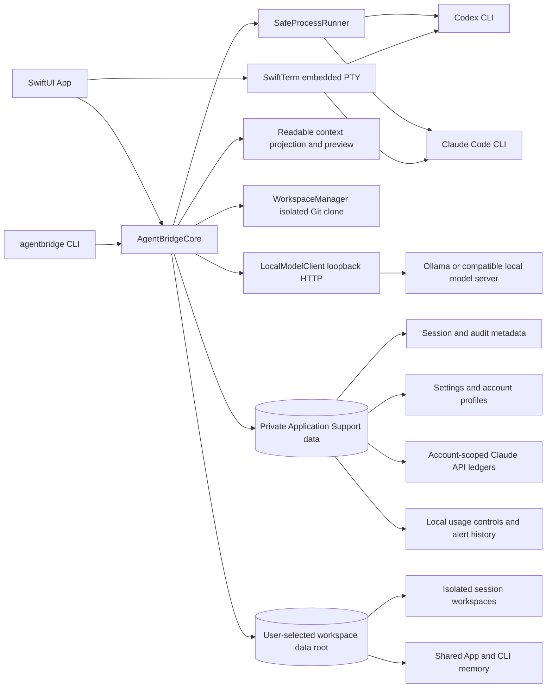

# AgentBridge Architecture and Design

[繁體中文](ARCHITECTURE.zh-TW.md)

The provider CLIs, SwiftTerm, and AgentBridgeCore in this diagram run on the user’s Mac. The selected folder contains isolated workspaces, shared memory, discussions, and the task board; private settings, account-profile data, session/audit metadata, usage controls, API ledgers, extension policy and execution consent, and autonomous-run state stay under Application Support. Cloud model requests use the selected provider's official CLI; explicit Local requests use a loopback HTTP service.

### Purpose and implementation

AgentBridge 0.10.0 is a standalone SwiftPM repository with a shared `AgentBridgeCore`, the `agentbridge` CLI, and a native SwiftUI app. The app and CLI use the same saved workspace-data root and private settings, account profiles, session index, audit store, usage controls, and API ledgers. The app defaults to English and includes bundled English and Traditional Chinese localizations with an in-app language preference. Its setup wizard resumes incomplete first-use setup and can be reopened from the header; `SetupWizardFlow` keeps the required workspace gate and optional CLI/sign-in readiness summary testable in the core. The embedded terminal uses SwiftTerm 1.20.0. `scripts/package-app.sh` assembles the release bundle, so the project does not maintain a second Xcode project configuration.

Provider execution goes through the official CLIs installed locally: Codex uses `codex exec --json` or its native interactive CLI; Claude Code uses `claude -p --output-format stream-json` or its native interactive CLI. AgentBridge does not export or copy OAuth credentials and does not treat a provider session ID as cross-provider memory. It manages local processes in Swift and does not add a Codex or Claude SDK runtime.

### App icon design

The deep-indigo icon links two distinct assistant nodes with a luminous bridge arc, representing shared project context between Codex and Claude. The 1024×1024 PNG is the source asset; the packaging script generates a macOS `.icns` and places it in the app bundle.

Official CLI options and authentication behavior can change. The official references and the locally checked CLI versions are listed in the README. Event parsing fails closed: an unknown login method, malformed event stream, or missing success event is not treated as success. Before running the app, confirm that the installed CLI versions still support the options used by the current implementation.

### Component responsibilities

| Component | Responsibility |
| --- | --- |
| `Models` | Provider, settings, account, session, access policy, event, and error types |
| `SafeProcessRunner` | Launches an executable with argv; bounds I/O; manages process groups, timeouts, cancellation, and PTY foreground handoff |
| `ProviderAdapters` | Builds provider arguments and environments, identifies login modes, parses events, and reads reported provider costs |
| `WorkspaceManager` | Creates an isolated detached Git clone under the selected workspace-data root, removes its remote, disables Git hooks, and verifies the pinned commit |
| `AuditStore` | Private Application Support settings and session/event JSONL, cross-process file locks, one-run leases, and cancellation markers |
| Workspace-root settings | Persists the selected user folder privately for both App and CLI; copies existing workspaces and memory on change without deleting source data |
| `AccountProfileStore` | Provider account labels, selected profile, isolated CLI configuration directories, and per-account memory consent |
| `SharedMemoryStore` | Stores cross-provider App/CLI read-only turns and user notes by canonical repository path and pinned commit |
| `ProjectMemoryStore` | Stores explicitly selected turn/note handoffs by canonical repository, with source/target commit provenance |
| `ParallelTaskBoard` | Records actual launched App/CLI operations, session status, approval, progress, cancellation, and result references |
| `ExtensionPolicyStore` | Stores inert descriptor metadata and explicit narrow per-project grants; it does not activate or execute provider extensions |
| Autonomous orchestration | Validates generated task graphs, binds approval, schedules dependencies and bounded review/repair, and persists run state |
| Active extension runtime | Stores Skill snapshots and MCP launch configurations with separate digest-bound execution consent |
| MCP proxy / Mac Control | Filters tools and calls against live grants; the Mac Control preset additionally enforces a target App and Observe/Control mode |
| `BudgetLedger` | Per-profile Claude API monthly limits, conservative reservations, and settlement; the built-in profile keeps the legacy US$140 ledger |
| `UsageControlStore` / `APICostControlLedger` | Per-account run and optional day/session USD caps, threshold deduplication, bounded settings audit, concurrent-call reservation, and bill-based recovery |
| `OutputRedactor` | Redacts common token formats and the API key supplied for the current run |
| CLI / SwiftUI App | Shared conversation, account switching, memory controls, embedded terminal, and per-run API confirmation |
| `SetupWizardFlow` | First-use and resumable setup navigation, required workspace gate, and optional provider readiness summary |

### Workspace data and private app data

On first launch, the app asks the user to choose or create a workspace-data folder. Sessions cannot start until a folder is configured; AgentBridge has no hidden Application Support fallback for workspaces. The saved root is available to both App and CLI. The CLI can set it with `agentbridge workspace set /absolute/path/to/folder` and show it with `agentbridge workspace show`; commands that need a root report the setup command if none is configured.

The setup wizard opens automatically when the app has no usable workspace root and resumes an unfinished first-use flow after restart. Existing installations with a usable root are not interrupted; the header's **Setup Wizard** button reopens the steps. The root is required to continue. CLI discovery, account sign-in checks, and usage controls are optional; the final summary lists missing items. The wizard does not automatically run a provider task or send a model request; saving account or default settings can prepare a local session. An official CLI sign-in or status check starts only after the user explicitly clicks its control. Provider and CLI-path choices are explicit drafts until saved. Existing provider mode and per-account memory consent remain intact when the wizard is reopened.

The chosen folder is organized as `<root>/workspaces/<lowercase-session-uuid>/` for unique isolated Git copies, `<root>/shared-memory/` for shared conversation memory, `<root>/discussions/` for chat-first discussions, and `<root>/task-board/` for the parallel task board. App settings, account-profile information, dedicated provider CLI profile directories (where those CLIs store profile credentials), session indexes, audit events, usage controls, budget ledgers, extension policy grants, active-extension execution consent, and autonomous-run state remain in the private `~/Library/Application Support/AgentBridge` directory, because the selected folder may be synced or shared. Earlier releases kept extension policy and runtime consent in the selected folder; on first start, a document that passes the store's integrity checks is imported once into private data when no private document exists yet. Invalid legacy documents are skipped, and the legacy copies are never modified or removed. The selected root itself is saved in that private app data.

Changing the selected root copies existing workspaces, shared memory, discussions, and task-board records to the new location, then updates existing session records to point to the copies. The previous directories remain intact. If a destination contains different data for an existing workspace, memory file, discussion, or task record, migration stops without overwriting either copy. A new root cannot be placed inside any folder AgentBridge manages in a current or prior root. New sessions are created under the selected root. A root change is a storage-location change only; it does not rewrite a session's source repository path or pinned commit.

### Chat-first discussions

Local model transport and readable context projection are described in [Local Models and Context](docs/LOCAL_MODELS_AND_CONTEXT.md). Managed read-only composition uses App-owned history; compressed history must not be combined with a resumed opaque vendor transcript that defeats the input budget. Original storage, approved context projection and model-reported usage are separate layers.

Discussion records have UUID-based identity independent of Git. Their bounded transcript lives below the selected data root and uses per-turn source/destination sharing consent. Every send uses subscription authentication, existing local usage controls and a fresh no-tool execution context. A reviewed, digest-bound handoff creates a new local repository with an empty initial commit or links an existing repository without modifying it, then copies approved context into the normal project memory scope. Original discussions remain available. See [Chat-first Workflow](docs/CHAT_FIRST_WORKFLOW.md).

### Sessions, workspace isolation, and accounts

When creating a session, AgentBridge reads the source repository's committed state, creates an isolated clone at `<selected root>/workspaces/<lowercase-session-uuid>/`, checks out a detached commit, and records the full commit hash. Read-only is the default. Isolated-change sessions are available only in subscription mode; they use the same pinned clone and require a reviewed plan to be explicitly approved before a provider write run. Codex uses its documented `workspace-write` sandbox; Claude uses `acceptEdits` with a narrow tool allowlist. The native interactive TUI remains a separate mode. Switching between Codex and Claude or between account profiles creates or reuses a session for the same source path and pinned commit. Later changes to the source `HEAD` do not silently change an existing session's scope. Uncommitted and untracked files are not copied.

Each session is bound to the provider account selected at creation. Switching the selected account does not change the account used by an existing session; return to that account or create another session. Each provider has a built-in profile for the current local login, plus optional isolated profiles. A custom profile receives its own `CODEX_HOME` or `CLAUDE_CONFIG_DIR`. The official CLI creates and reads credentials; AgentBridge does not parse or copy them. The built-in profile has no relogin action, to avoid changing the existing login.

### Change review, verification, tasks, and extension policy

The change workflow stores a plan digest on the session and binds approval to that exact plan. A later plan edit invalidates approval. Changes remain in the isolated workspace; the source tree is not written. The UI exposes full per-file diffs, restore-per-file and restore-all actions, and patch export. Verification is a separate user-started process in the session workspace: `.codex/ci.sh` is the default; custom executable paths and argv are accepted only after explicit approval and are passed directly without shell interpolation. Acceptance and branch apply require successful verification whose digest matches the current diff. Apply checks the original source base commit and creates an uncommitted worktree on the named local branch. AgentBridge does not commit, push, or merge.

The activity timeline renders ordered redacted `AuditEvent` records and reports provider output only when the official CLI actually emitted it. The task board persists each launched operation, its progress, approval state, terminal status, and diff/verification references. The App limits its own concurrent runs to three different sessions; process-level run leases shared with the CLI prevent overlapping managed runs in the same session. Cancellation and run leases are scoped to each session. A task record is not created as running for an operation that was never launched.

Legacy extension descriptors and per-project policy grants remain metadata only. The separate active runtime imports actual bounded Skill instruction snapshots or installed local stdio MCP configurations. Activation requires a reviewed digest and explicit execution consent for the project, provider and profile. Skill instructions are added to managed prompts; MCP servers are launched through a per-run proxy that filters discovery and calls against the approved tool list. Mac Control adds target-App enforcement, separate screen/input consent, live revocation and cancellation. Its screenshots include the whole main display. No runtime edits global provider settings, installs packages or executes Skill hooks/scripts. See [Autonomous Workflows and Active Extensions](docs/AUTONOMY_AND_EXTENSIONS.md).

Autonomous planning uses a readonly subscription session and strictly validates the generated task graph. User approval binds source commit, role accounts, task prompts, scope, extensions, sharing, verifier and execution limits. The scheduler runs independent investigations concurrently, then coordinates isolated implementation and exact-diff review with bounded repairs. Approved verification may run inside that workflow; results are never automatically accepted or applied. Changed bindings, failed prerequisites, malformed review or cancellation stop further work. Persistent state is shared with the CLI; interrupted runs are not replayed.

Account and plan details come only from fields reported by the official CLI. Claude CLI can report its login account and subscription plan. If the Codex CLI does not report a plan name, the app shows the verified login status without guessing a plan. Users complete sign-in for additional profiles through the official CLI's interactive login flow.

### Shared memory

A successful non-interactive read-only run from the app or CLI is stored in `<selected root>/shared-memory/` only after the provider run succeeds; both use the same selected root. Memory is scoped by the canonical source repository path and the commit pinned when the session was created, so Codex and Claude can use the same memory for the same repository snapshot. The workspace-data root is not part of the memory key: selecting a different root does not change memory identity. A different source path or commit has a separate memory scope. Stored content includes the explicitly submitted prompt, successful response, and user notes. It is redacted and bounded by Unicode-safe truncation, size, and turn-count limits before being written to owner-only files.

Cross-commit continuity is explicit. A user selects specific App-owned turns and/or notes from a source session for a target session with the same canonical repository and a different pinned commit. The target account must allow shared memory. Handoffs are stored under `<selected root>/shared-memory/project-handoffs/`. Only handoffs matching the target commit are included in that session's next allowed prompt; a JSON envelope carries the selected text and source/target provenance as untrusted historical context under a 16 KiB limit. Native TUI transcripts are never imported.

Built-in and newly created account profiles allow shared memory by default. Users can turn it off for each account; doing so preserves prior memory but stops that account from automatically loading or saving turns. Existing profiles retain their stored consent setting when the app is updated. Users can view or clear stored memory in the app.

Each provider CLI controls whether its native TUI transcript is persisted. AgentBridge does not capture general TUI screens or parse provider session files. The separate subscription-usage parser is described below. At interactive-session startup, if the profile allows memory and memory exists, AgentBridge supplies it through a private, temporary context file and removes that file when the process ends. Text entered in the TUI is not written back automatically; users can save handoff notes manually. Memory is treated as historical context and is instructed not to override provider policies, access rules, or payment rules.

### Process safety and access boundaries

Non-interactive commands launch an executable with a separate argv array; they do not build a shell command string. Prompts go over standard input. Child processes receive an allowlisted environment rather than inheriting API keys, proxy settings, or cloud credentials by default. Output and error buffers are bounded, and audit events redact common secrets. Runs use a per-session lease, cancellation marker, process-group termination, and bounded termination escalation. CLI SIGINT, SIGTERM, and SIGHUP are also converted into cancellation.

Non-interactive read-only Codex uses a read-only sandbox and never requests elevated approval. Non-interactive read-only Claude limits built-in tools to `Read,Glob,Grep` and uses `dontAsk`; hooks and unapproved MCP servers remain disabled. Explicitly approved MCP runs use the proxy, because Claude's built-in `--tools` restriction does not filter MCP tools. External tools can affect systems beyond the repository, so their separately reviewed capabilities remain visible. Isolated-change runs use Codex `workspace-write` or Claude `acceptEdits` with narrow built-in tools; the workspace is a workflow boundary, not a macOS sandbox. Headless Codex cannot prompt for additional runtime permissions, and AgentBridge does not bypass approval. Native interactive mode retains each provider TUI: Codex stays readonly, while Claude uses Manual permissions. A command approved in the native TUI may access files or networks beyond the workspace.

The embedded terminal connects a PTY directly to the official CLI and does not save raw terminal input or screen output. Only after the fixed `/usage` action, the app copies a bounded number of visible SwiftTerm rows into memory for best-effort parsing; sampling stops when usage values are recognized or after 15 seconds, and another fixed action can re-arm it. The app discards that raw text after producing the normalized report and never logs, persists, or sends it to a model. SwiftTerm OSC 52 clipboard access and terminal link opening are disabled, and scrollback is bounded. The separate local-terminal action starts the user's shell with the current macOS account's permissions; the repository clone does not restrict its filesystem or network access.

Git cloning disables hooks, fsmonitor, untracked cache, and LFS smudge, removes `origin`, and uses a private Git configuration directory. Uncommitted content, LFS object material, and submodules not initialized separately are not guaranteed to be part of a complete snapshot. AgentBridge does not commit, push, merge, or clean the source repository automatically.

### Claude API budget and authorization

The default is subscription login through the official CLI. Claude API is an explicit paid path. Every run requires an API key, a per-run USD budget, and explicit authorization. The Codex UI has no Claude API controls; switching to Codex forces subscription mode. The built-in Claude profile preserves the legacy local US$140 monthly ledger. Each additional Claude profile requires its own monthly cap and ledger; its cap is fixed after the ledger is created so prior spend cannot be reinterpreted. App and CLI share these account-scoped ledgers. Each call reserves twice its requested budget against the monthly and optional UTC-day/session caps before launch, and only one unresolved paid call is allowed across both front ends. The API key is passed only to that run's child process and is not written to settings or audit files.

Claude CLI's `--max-budget-usd` uses client-side cost estimates; it is not a hard cap on the provider bill. AgentBridge uses `total_cost_usd` from a successful response for automatic settlement. If the cost is missing, the run fails, or it is cancelled, the reservation remains instead of assuming that unknown usage was free; the user can reconcile it against the provider bill in the app or CLI, with idempotent retries across the monthly and day/session ledgers. API sessions do not resume subscription sessions, and development checks do not call a model. The local ledger cannot see usage outside AgentBridge; use Anthropic Console spending controls if provider-side limits are needed.

### Usage statistics and alerts

The app charts AgentBridge-managed run attempts by selected account over rolling 5-hour, 24-hour, and 7-day windows, and the selected AgentBridge session. Optional local run-count caps are enforced before managed subscription or API launches. For Claude API, the dashboard separately shows monthly spent/reserved/available amounts and optional UTC-day/session USD caps, plus API run counts. One-time 50%, 75%, 90%, and 100% alerts are deduplicated by account and period; macOS notifications are optional, and threshold crossings are recorded in bounded local audit history. These figures count only AgentBridge-managed attempts and charges.

Codex and Claude do not expose the provider's subscription quota percentages and reset windows through a stable machine-readable source used by this app. The dashboard directs users to the official CLI `/usage` screen, then can show recognized fields in a unified best-effort card. It matches provider-specific usage-window wording and only reads percentages inside recognized usage sections; unknown fields show “Not provided / 未提供.” This parser is not a stable API, and the visible TUI remains the source of truth. Native interactive TUI turns are neither counted nor capped.

The subscription usage dashboard can open the selected account's official interactive CLI through the embedded PTY. The CLI helper rechecks subscription authentication for that exact profile, applies its existing CODEX_HOME or CLAUDE_CONFIG_DIR, and launches in a newly created private empty temporary working directory that is removed when the process exits. Codex starts with its read-only sandbox, no approval prompts, and optional integrations disabled. Claude starts in restricted Plan mode with no built-in tools, hooks, or MCP servers; it forces claude.ai authentication, sets CLAUDE_CODE_SKIP_PROMPT_HISTORY=1, and passes --no-session-persistence. The launch supplies no model prompt or non-interactive command. After the user sees the CLI prompt and completes sign-in if needed, a separate fixed UI action sends /usage followed by Enter. API mode hides the action and the core rejects it. API key variables are excluded from the child environment. The normalizer returns only the provider, selected account, recognized plan/window percentages/reset text, source, status, and capture time; unrecognized values stay nil. It does not claim structured quota values or make API/SDK/model calls.

### Local data and remaining limitations

Private settings, account profiles, dedicated provider CLI profile directories (where those CLIs save profile credentials), session/audit metadata, usage controls, and budget ledgers live under `~/Library/Application Support/AgentBridge`, protected with private directory permissions and file locks. Isolated session workspaces, shared memory, discussions, and the task board live under the user-selected workspace-data root; extension consent and autonomous-run state do not. AgentBridge stores the selected root in private Application Support so the App and CLI stay aligned. Changing that root copies existing workspace, memory, discussion, and task-board data without removing the previous copies. Redaction is best effort and cannot recognize every unknown secret format. The built-in profiles continue to use the provider CLIs' existing login directories. The same macOS user can manually alter local settings, usage controls, and ledgers, so this tool is not intended as a multi-user or remote untrusted service.

### Build and acceptance boundary

The packaging script converts `Assets/AppIcon-1024.png` into the standard macOS iconset, writes `Contents/Resources/AgentBridge.icns`, and sets the app icon key in Info.plist.

`.codex/ci.sh` is the primary local validation entry point and builds the CLI/app and runs core tests. `scripts/package-app.sh` creates an unsigned Release `.app` with the CLI helper, SwiftTerm resources, and license. For distribution, use a Developer ID Application certificate, sign the embedded helper first and then the `.app`, submit it to Apple for notarization, staple the ticket, and verify it. SwiftPM state, module caches, and DerivedData live under the repository's `build/` directory. If SwiftPM's default Metal shader backend cannot build SwiftTerm with the installed Xcode toolchain, the project scripts use SwiftPM's native backend, which is currently deprecated. Recheck toolchain compatibility before upgrading Xcode or SwiftTerm.

Tests use mock CLIs, temporary Git repositories, and local processes; they do not require an API key, provider login, or paid calls. Passing automated checks does not verify live provider execution, additional-account sign-in, Anthropic billing, or GUI operation. Report those as separate acceptance results. See the [README](README.md) for official CLI references and the [How to Use guide](docs/HOW_TO_USE.md) for operator steps.
