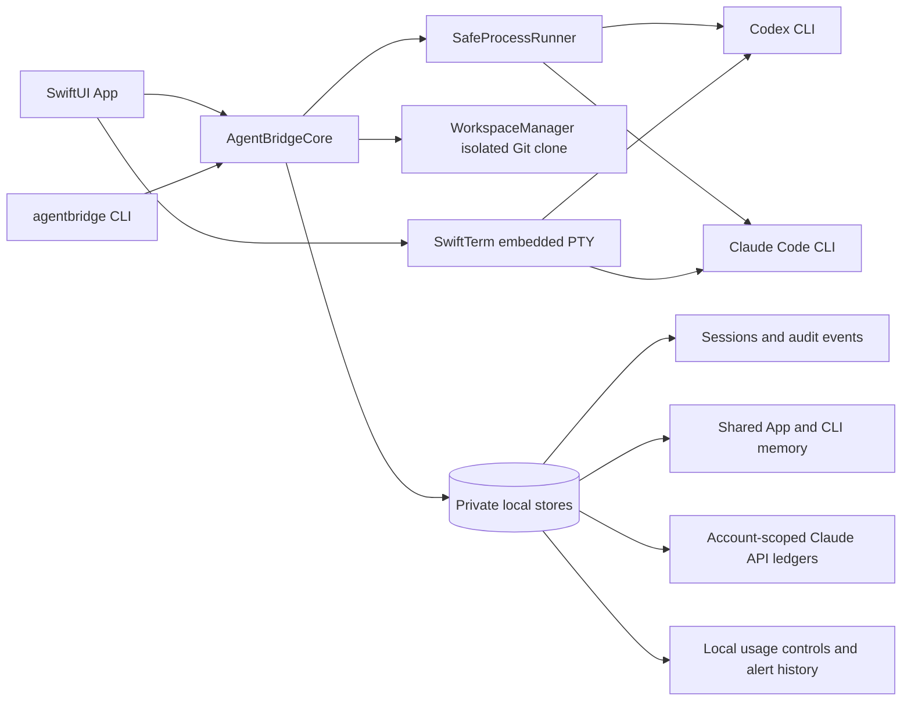

# AgentBridge 技術架構與設計

[英文版](ARCHITECTURE.md)

圖示中的 provider CLI、SwiftTerm 與 AgentBridgeCore 都在使用者的 Mac 上執行。共享記憶、稽核資料、用量控制與 API 帳本留在本機；模型請求依選定的官方 CLI 傳送至對應 provider。

## App icon 設計

Icon 以深靛藍底色呈現兩個不同助理節點，透過一道明亮的弧形橋接，代表 Codex 與 Claude 共用專案脈絡。1024×1024 PNG 是來源資產；打包腳本會產生 macOS `.icns` 並放進 App bundle。

## 目標與實作方式

AgentBridge 0.3.0 是獨立的 SwiftPM Repository，提供共用 `AgentBridgeCore`、`agentbridge` CLI 與原生 SwiftUI App。App 和 CLI 共用設定、帳戶、會話、權限、工作區、記憶、稽核與預算程式碼。App 的內嵌終端使用 SwiftTerm 1.20.0；Release bundle 由 `scripts/package-app.sh` 組裝，不維護兩份 Xcode 專案設定。

供應商整合透過本機官方 CLI 執行：Codex 使用 `codex exec --json` 或原生互動 CLI，Claude Code 使用 `claude -p --output-format stream-json` 或原生互動 CLI。程式不匯出或複製 OAuth 憑證，也不把 CLI session ID 當成跨供應商記憶。此專案使用 Swift 管理本機程序，不另外引入 Codex/Claude SDK runtime。

官方 CLI 參數與驗證行為會演進。實作查核所依據的官方來源及當時本機版本列於 README；事件解析採 fail-closed，未知登入方式、事件格式錯誤或缺少成功事件都不會被推定為成功。使用者執行前仍應確認目前安裝版本支援 README 中列出的選項。

## 模組責任

| 模組 | 責任 |
| --- | --- |
| `Models` | provider、設定、帳戶、工作階段、權限、事件及錯誤型別 |
| `SafeProcessRunner` | 以 executable 和 argv 啟動程序；有界 I/O、程序群組、逾時、取消及 PTY 前景交接 |
| `ProviderAdapters` | 建立安全參數與環境、辨識登入方案、解析事件與供應商費用 |
| `WorkspaceManager` | 建立獨立 detached Git clone、移除遠端、停用 Git hooks，並驗證固定提交 |
| `AuditStore` | 私有設定、session/event JSONL、跨程序檔案鎖、單一執行租約及取消標記 |
| `AccountProfileStore` | provider 帳戶標籤、選取狀態、分離 CLI 設定目錄及逐帳戶記憶同意 |
| `SharedMemoryStore` | 依 canonical Repository 路徑及固定提交儲存跨供應商回合與使用者備註 |
| `BudgetLedger` | 依帳戶分開的 Claude API 月度上限、保守預留和結算；內建帳戶沿用舊版 US$140 帳本 |
| `UsageControlStore` / `APICostControlLedger` | 逐帳戶執行次數與選用日／工作階段 USD 上限、門檻去重、有筆數上限的設定稽核、並行呼叫預留及帳單恢復 |
| `OutputRedactor` | 遮蔽常見 token 格式與本次已知 API key |
| CLI / SwiftUI App | 共用對話、帳戶切換、記憶管理、內嵌終端與單次 API 確認介面 |

## 會話、隔離與切換

建立 session 時，AgentBridge 讀取來源 Repository 的已提交版本，使用獨立 clone 建立隔離工作區並記錄完整 commit hash。切換 Codex/Claude 或切換帳戶時，以同一來源路徑和原固定提交建立或重用對應工作階段，來源 Repository 的 HEAD 即使後續改變也不會偷偷改變既有對話範圍。未提交與未追蹤檔不會複製。

每個 session 綁定建立時所選的 provider 帳戶。切換帳戶後，舊 session 不會改用新帳戶續行；需切回原帳戶或建立新的 session。Codex 和 Claude 各自有內建「目前本機登入」 profile，以及可選擇新增的獨立 profile。新增 profile 使用專屬 `CODEX_HOME` 或 `CLAUDE_CONFIG_DIR`，憑證由官方 CLI 建立及讀取，AgentBridge 不解析或複製憑證。內建帳戶不提供重新登入按鈕，避免改動既有登入。

方案與帳戶資訊只顯示官方 CLI 驗證狀態實際回報的欄位。Claude CLI 可回報登入帳號和訂閱方案；Codex CLI 若未提供方案欄位，畫面不自行推測。建立其他帳戶時，使用者必須在官方登入流程完成登入。

## 共用記憶

App 與 CLI 的唯讀聊天回合只在 provider 執行成功後寫入本機共用記憶；兩者指向相同私有資料目錄。記憶範圍由 canonical Repository 路徑及建立 session 時固定的 commit hash 組成，同一固定版本可由 Codex 與 Claude 共用。更換來源路徑或 commit 會得到另一份記憶。記憶內容包含明確送出的提示、成功回應及使用者備註，經敏感字串遮蔽、Unicode 安全截短及大小/回合數上限後寫入 owner-only 檔案。

內建帳戶與新建帳戶預設都允許讀取和保存 AgentBridge 共用記憶。使用者可在每個帳戶設定中關閉；關閉不會刪除歷史內容，只會停止該帳戶自動載入或保存回合。既有帳戶的已儲存同意設定不會因更新而改變。記憶可在 App 內查看或清除。

provider CLI 決定原生互動 TUI transcript 是否保存。AgentBridge 不會截取一般 TUI 畫面或解析供應商 session 檔；訂閱用量的獨立解析流程見下文。互動工作階段開始時，若帳戶允許共用記憶且已有內容，AgentBridge 會以私有、短暫 context 檔提供歷史資料，結束後刪除檔案。互動期間新增的 TUI 文字不會自動回寫；使用者可在備註區手動保存交接重點。記憶內容是歷史資料，provider 提示要求其不得覆蓋權限、政策或付款規則。

## 執行安全與權限

非互動程序使用直接 executable/argv，不經 shell；提示透過標準輸入提供。子程序環境採白名單，不繼承 API key、proxy 或雲端憑證。輸出與錯誤緩衝有上限，原始 provider stderr 不寫入稽核記錄。執行有每 session 租約、取消標記、程序群組終止及 bounded escalation；CLI 的 SIGINT/SIGTERM/SIGHUP 也會轉為取消。

Codex 非互動使用 read-only sandbox 及不升權核准；Claude 非互動限於 `Read,Glob,Grep`、關閉 hooks/MCP，並使用 `dontAsk`。原生互動模式保留 provider TUI，Codex 維持唯讀 sandbox，Claude 使用 Manual 權限模式；使用者核准的 Claude 指令可能編輯隔離 clone，也可能讀取工作區外資料或使用網路。隔離 clone 是工作流程邊界，不是 macOS sandbox。

內嵌終端直接將 PTY 接到官方 CLI，不保存原始終端畫面或輸入。只有按下固定的 `/usage` 按鈕後，App 才會將有限數量的可見 SwiftTerm 列暫存在記憶體供盡力解析；辨識到用量值或 15 秒後停止取樣，再按固定按鈕可重新啟動。正規化報告產生後即丟棄原始文字，不會記錄、保存或傳給模型。SwiftTerm 不允許 OSC 52 剪貼簿讀寫及 terminal link 開啟，並限制 scrollback。獨立「本機終端機」使用者 shell 以目前 macOS 帳戶權限執行；Repository clone 不會限制其檔案或網路存取。

Git clone 停用 hooks、fsmonitor、untracked cache 及 LFS smudge，移除 origin 並使用私有 Git 設定目錄。未提交內容、LFS 實體檔及未另行初始化的 submodule 不會因此成為完整快照。AgentBridge 不會自動對來源 Repository 做 commit、push、merge 或清理。

## Claude API 額度

預設只使用官方 CLI 的訂閱登入。Claude API 只能明確切換，並且每次執行都要求 API key、單次 USD 預算和付費確認；Codex 畫面沒有 Claude API 控制項，切至 Codex 會強制回到訂閱模式。App 和 CLI 共用以整數微美元保存的 US$140 UTC 月度本機帳本。每次執行預留單次預算兩倍，以協調並行呼叫；API key 只放入該次子程序環境，不寫入設定或稽核檔。

Claude CLI 的 `--max-budget-usd` 依客戶端估算，不是供應商帳單的硬上限。有效回應的 `total_cost_usd` 用於自動結算；費用缺漏、失敗或取消時保留預算，避免把未知支出當成免費。使用者可在 App 或 CLI 依 provider 帳單手動結算，月度與日／工作階段帳本可用相同金額安全重試。API 執行不續用訂閱 session，也不會在開發測試中呼叫模型。內建 Claude 帳戶沿用舊版 US$140 本機月度帳本；每個新增 Claude 帳戶必須設定獨立月上限並使用自己的帳本，帳本建立後上限固定。App 與 CLI 共用各帳戶帳本；每次呼叫會在啟動前，針對月、選用 UTC 日與工作階段上限預留所輸入單次預算的兩倍，並且最多允許一筆費用未確認的付費呼叫。API key 只提供給該次子程序，不會寫入設定或稽核檔。本機帳本無法查看其他工具或 AgentBridge 外部的用量；需供應商端限制時，請另在 Anthropic Console 設定。

## 用量統計與提醒

App 依選取帳戶動態統計 AgentBridge 管理的執行嘗試，顯示滾動近 5 小時、24 小時、7 天及目前 AgentBridge 工作階段，並提供 7 天活動圖表。可選擇設定訂閱和 API 的本機執行次數上限，管理執行啟動前會檢查。Claude API 另有月度已用／保留／可用額度，以及選用 UTC 日和工作階段 USD 上限。達到 50%、75%、90% 和 100% 時依帳戶及週期只提醒一次；macOS 通知為選用，門檻事件保存在有筆數上限的本機稽核歷程。這些數字只統計 AgentBridge 管理的執行和支出。

此 App 使用的官方介面沒有提供 Codex 或 Claude 訂閱額度百分比和重置週期的穩定機器可讀來源。用量面板會引導使用者查看官方 CLI `/usage` 畫面，再以 provider 專用的盡力辨識器填入統一資料卡；只會從已辨識的用量區段讀取百分比，未知欄位顯示「Not provided / 未提供」。解析器不是穩定 API，原生 TUI 仍是依據。原生互動 TUI 回合不會計入或受本機上限控制。

訂閱用量面板可透過內嵌 PTY 開啟目前所選帳戶的官方互動 CLI。命令列輔助程式會針對該帳戶重新檢查訂閱登入，套用其既有的 CODEX_HOME 或專屬 CLAUDE_CONFIG_DIR，並在全新、私有的空白暫存工作資料夾中啟動；程序結束後會刪除資料夾。Codex 使用唯讀 sandbox、不提出核准提示，並停用選用整合。Claude 使用 restricted Plan 模式，不載入內建工具、hooks 或 MCP，強制 claude.ai 登入，設定 CLAUDE_CODE_SKIP_PROMPT_HISTORY=1，並傳入 --no-session-persistence。啟動時不提供模型提示或非互動命令。使用者看到 CLI 提示符並完成登入後，可按另一個固定 UI 按鈕送出 /usage 和 Enter。Claude API 模式會隱藏此操作，核心也會拒絕 API 模式啟動。子程序環境不包含 API key 變數。正規化報告只包含 provider、所選帳戶、已辨識的方案／用量視窗百分比／重置文字、來源、狀態和擷取時間；無法辨識的值維持空值。不會宣稱這些是結構化額度資料，也不會呼叫 API、SDK 或模型。

## 資料與剩餘邊界

App/CLI 資料位於 `~/Library/Application Support/AgentBridge`，由私有目錄及檔案鎖保護。敏感遮罩採最佳努力，無法識別所有未知秘密。provider CLI 仍可依其自身政策保存帳戶或 session 資料。同一 macOS 使用者也能手動更改本機資料、用量控制及帳本；此工具不適合作為多人或遠端不受信任服務。

## 建置及驗收

封裝腳本會將 `Assets/AppIcon-1024.png` 轉成標準 macOS iconset，再產生 `Contents/Resources/AgentBridge.icns` 並在 Info.plist 設定 App icon 欄位。

`.codex/ci.sh` 是主要本機驗證入口，會建置 CLI/App 並跑核心測試。`scripts/package-app.sh` 會建立未簽署的 Release `.app`，包含 CLI helper、SwiftTerm 資源及授權。正式交付需使用 Developer ID Application 憑證，先簽署嵌入的 helper，再簽署 `.app`，送交 Apple 公證、staple ticket 並驗證。SwiftPM 狀態、模組快取和 DerivedData 等建置資料放在 Repository 的 `build/`。若 SwiftPM 預設 Metal shader backend 無法在目前 Xcode 工具鏈編譯 SwiftTerm，專案腳本會使用 SwiftPM 的 native backend；該 backend 目前已棄用，升級 Xcode 或 SwiftTerm 前要重新確認工具鏈相容性。

測試使用 mock CLI、臨時 Git Repository 和本機程序，不需要 API key、登入或付費呼叫。通過自動檢查不代表真實 provider 執行、新增帳戶登入、Anthropic 帳務或 GUI 操作已驗收；交付時分別列出各項實際結果。

官方 CLI 文件連結、建置步驟與對 CLI 限制的說明請見 [繁體中文版 README](README.zh-TW.md)。

---
