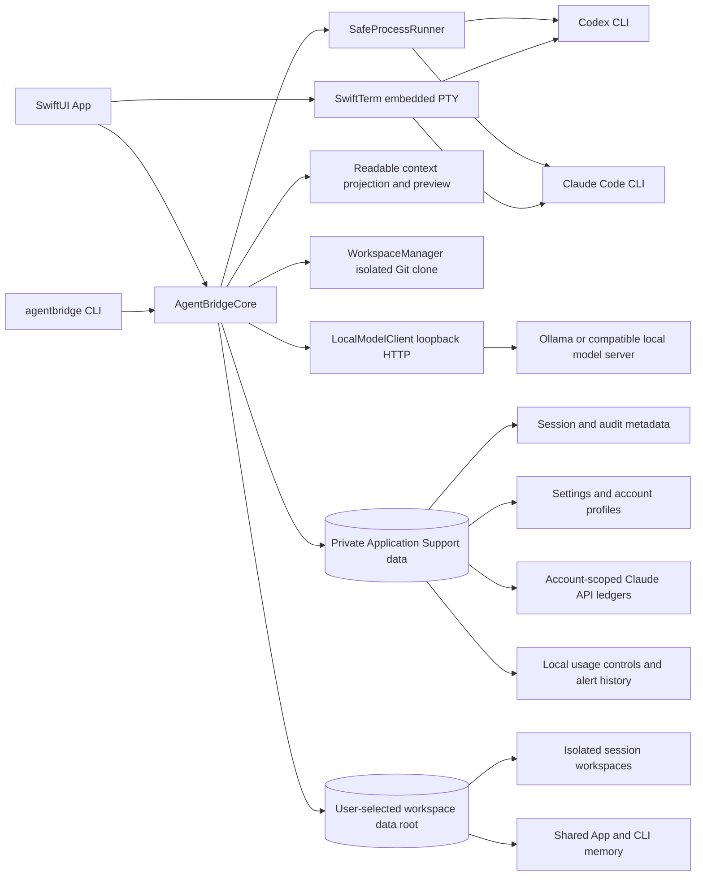

# AgentBridge 技術架構與設計

[英文版](ARCHITECTURE.md)

圖示中的 provider CLI、SwiftTerm 與 AgentBridgeCore 都在使用者的 Mac 上執行。使用者自選資料夾存放隔離工作區、共用記憶、討論與任務看板；私有設定、帳戶資料、工作階段／稽核中繼資料、用量控制、API 帳本、擴充功能政策與執行同意，以及自主執行狀態留在 Application Support。模型請求依選定的官方 CLI 傳送至對應 provider。

## App icon 設計

Icon 以深靛藍底色呈現兩個不同助理節點，透過一道明亮的弧形橋接，代表 Codex 與 Claude 共用專案脈絡。1024×1024 PNG 是來源資產；打包腳本會產生 macOS `.icns` 並放進 App bundle。

## 目標與實作方式

AgentBridge 0.11.2 是獨立的 SwiftPM Repository，提供共用 `AgentBridgeCore`、`agentbridge` CLI 與原生 SwiftUI App。App 和 CLI 共用已保存的工作區資料根目錄，以及私有設定、帳戶、工作階段索引、稽核、用量控制與 API 帳本。App 預設使用英文，並內建英文與繁體中文資源，可在 App 內選擇並保存語言。Core、CLI 與 App 的訊息原文一律是英文；繁體中文放在 `zh-Hant.lproj`，以整句或整句範本（例如 `Loaded %@ turn(s)`，其中擷取的值會再各自翻譯）對照。`en.lproj/Legacy.strings` 保留舊的中文對英文條目，讓這次改版前已保存的稽核事件在英文介面仍顯示為英文。CLI 只輸出英文。設定精靈會續接尚未完成的首次設定，也可從標題列重新開啟；`SetupWizardFlow` 將必要的工作區限制與選用的 CLI／登入狀態摘要做成可測試的核心邏輯。App 的內嵌終端使用 SwiftTerm 1.20.0；Release bundle 由 `scripts/package-app.sh` 組裝，不維護兩份 Xcode 專案設定。

供應商整合透過本機官方 CLI 執行：Codex 使用 `codex exec --json` 或原生互動 CLI，Claude Code 使用 `claude -p --output-format stream-json` 或原生互動 CLI。程式不匯出或複製 OAuth 憑證，也不把 CLI session ID 當成跨供應商記憶。此專案使用 Swift 管理本機程序，不另外引入 Codex/Claude SDK runtime。

官方 CLI 參數與驗證行為會演進。實作查核所依據的官方來源及當時本機版本列於 README；事件解析採 fail-closed，未知登入方式、事件格式錯誤或缺少成功事件都不會被推定為成功。使用者執行前仍應確認目前安裝版本支援 README 中列出的選項。

## 模組責任

| 模組 | 責任 |
| --- | --- |
| `Models` | provider、設定、帳戶、工作階段、權限、事件及錯誤型別 |
| `SafeProcessRunner` | 以 executable 和 argv 啟動程序；有界 I/O、程序群組、逾時、取消及 PTY 前景交接 |
| `ProviderAdapters` | 建立安全參數與環境、辨識登入方案、解析事件與供應商費用 |
| `WorkspaceManager` | 在使用者自選的工作區資料根目錄建立獨立 detached Git clone、移除遠端、停用 Git hooks，並驗證固定提交 |
| `AuditStore` | Application Support 中的私有設定、session/event JSONL、跨程序檔案鎖、單一執行租約及取消標記。session 索引超過 2 MiB 時會壓縮成每個 session 一行；稽核檔滿時會縮短較舊的 `run.output` 事件文字（不刪除事件本身），不再直接失敗；解碼後的索引與事件在檔案未變動前會重複使用 |
| 工作區根目錄設定 | 將使用者選擇的資料夾私下保存供 App 與 CLI 共用；變更時安全複製既有工作區與記憶，不刪除來源資料 |
| `AccountProfileStore` | provider 帳戶標籤、選取狀態、分離 CLI 設定目錄及逐帳戶記憶同意 |
| `SharedMemoryStore` | 依 canonical Repository 路徑及固定提交儲存跨供應商回合與使用者備註 |
| `ProjectMemoryStore` | 依 canonical Repository 儲存明確選取的回合／備註交接，並保留來源／目標提交 provenance |
| `ParallelTaskBoard` | 記錄實際啟動的 App/CLI 操作、工作階段狀態、核准、進度、取消及結果參照 |
| `ExtensionPolicyStore` | 保存惰性 descriptor metadata 與明確的每專案狹窄授權；不會啟用或執行 provider extension |
| 自主編排 | 驗證模型產生的任務圖、綁定核准、排程相依任務與有限次審查修正，並保存流程狀態 |
| 擴充執行器 | 保存 Skill 快照與 MCP 啟動設定，另行要求綁定摘要的執行同意 |
| MCP 代理／Mac Control | 依有效授權過濾工具與呼叫；Mac Control 另強制限制目標 App 及觀察／控制模式 |
| `APISpendLedger` | 每個帳戶一份 Claude API 帳本：保守預留時一次寫入即同時檢查月上限與選用的 UTC 日／工作階段上限，並阻擋並行呼叫及處理結算；內建帳戶沿用舊版 US$140 上限 |
| `UsageControlStore` | 逐帳戶執行次數上限與 USD 上限設定、門檻去重，以及有筆數上限的設定稽核 |
| `OutputRedactor` | 遮蔽常見 token 格式與本次已知 API key |
| CLI / SwiftUI App | 共用對話、帳戶切換、記憶管理、內嵌終端與單次 API 確認介面 |

## 工作區資料與私有 App 資料

第一次啟動且沒有可用工作區根目錄時，App 會自動開啟設定精靈並要求使用者選擇或建立資料夾；設定完成前不會建立工作階段。精靈會在重啟後續接尚未完成的首次流程。有可用根目錄的既有安裝不會被打擾，可用標題列的「設定精靈」重新開啟。工作區是唯一必填項目；CLI 尋找、帳戶登入檢查與用量控制可先略過，最後摘要會清楚標示尚未完成項目。精靈不會自動執行 provider 工作或傳送模型請求；儲存帳戶或預設設定時可能會準備本機工作階段。只有使用者明確按下按鈕後，才會啟動官方 CLI 進行登入或狀態檢查。供應商與 CLI 路徑在明確儲存前都只是草稿；重新開啟精靈不會變更既有 provider 模式或每個帳戶的記憶同意設定。

App 與 CLI 共用已保存的根目錄。CLI 可用 `agentbridge workspace set /absolute/path/to/folder` 設定，並以 `agentbridge workspace show` 查看；需要該資料夾的命令若發現尚未設定，會顯示可直接執行的設定指令。

使用者選擇的資料夾採用 `<root>/workspaces/<小寫工作階段 UUID>/` 存放每個工作階段的獨立 Git 複本，以 `<root>/shared-memory/` 存放 App/CLI 共用對話記憶，以 `<root>/discussions/` 存放先聊天後選專案的討論，並以 `<root>/task-board/` 存放平行任務看板。App 設定、帳戶設定資料、各 provider CLI 專用的 profile 資料夾（CLI 會在其中保存該 profile 的登入資料）、工作階段索引、稽核事件、用量控制、預算帳本、擴充功能政策授權、啟用擴充功能的執行同意及自主執行狀態，仍存放在私有的 `~/Library/Application Support/AgentBridge`，因為自選資料夾可能被同步或共享。舊版本將擴充功能政策與執行同意存放在自選資料夾；首次啟動時，若私有位置尚無文件，通過該儲存區完整性檢查的舊文件會一次性匯入私有資料。無效的舊文件會被略過，舊副本永不修改或刪除。已選根目錄也會保存在該私有資料夾。

變更根目錄時，AgentBridge 會將既有工作區、共用記憶、討論與任務看板記錄複製到新位置，再以單次寫入更新既有工作階段記錄以指向新副本。根目錄會先於工作階段記錄保存，因此中斷時工作階段仍使用先前完整的副本；再次選擇同一根目錄即可完成更新。舊資料夾仍保持原樣。若目的地已有不同內容的工作區、記憶檔、討論或任務記錄，遷移會停止且不會覆寫任一副本。新根目錄不能位於目前或先前根目錄中任何由 AgentBridge 管理的資料夾內。新工作階段會建立在目前所選的根目錄。變更的是存放位置，不會改寫工作階段的來源 Repository 路徑或固定提交版本。若根目錄位於 iCloud Drive、Dropbox、OneDrive、Google Drive 或 Box，App 與 CLI 會提出警告但不拒絕：逐字稿、共用記憶與工作區副本會因此離開這台 Mac，而檔案鎖只能協調同一台 Mac 上的程序。

## 會話、隔離與切換

建立 session 時，AgentBridge 讀取來源 Repository 的已提交版本，在 `<selected root>/workspaces/<小寫工作階段 UUID>/` 建立獨立 clone，並記錄完整 commit hash。唯讀為預設。隔離變更工作階段只支援訂閱模式，使用同一個固定 clone，且 provider 寫入前必須先檢視並明確核准工作計畫。Codex 使用官方 `workspace-write` sandbox；Claude 使用 `acceptEdits` 與狹窄工具允許清單。原生互動 TUI 是另一種模式。切換 Codex/Claude 或切換帳戶時，以同一來源路徑和原固定提交建立或重用對應工作階段，來源 Repository 的 HEAD 即使後續改變也不會偷偷改變既有對話範圍。未提交與未追蹤檔不會複製。

每個 session 綁定建立時所選的 provider 帳戶。切換帳戶後，舊 session 不會改用新帳戶續行；需切回原帳戶或建立新的 session。Codex 和 Claude 各自有內建「目前本機登入」 profile，以及可選擇新增的獨立 profile。新增 profile 使用專屬 `CODEX_HOME` 或 `CLAUDE_CONFIG_DIR`，憑證由官方 CLI 建立及讀取，AgentBridge 不解析或複製憑證。內建帳戶不提供重新登入按鈕，避免改動既有登入。

### 變更審查、驗證、任務與擴充政策

變更流程會將計畫摘要綁定工作階段；計畫內容變更會使先前核准失效。修改留在隔離工作區，不會寫入來源樹。App 提供完整逐檔 diff、單檔／全部還原與 patch 匯出。驗證是由使用者另行啟動、在工作階段工作區執行的程序，以 macOS 使用者身分執行且沒有沙箱，因此即使指令碼未變更，也會執行它呼叫的工作區程式碼：預設為 `.codex/ci.sh`，且因供應商可編輯工作區，只有它仍是固定提交版本中的可執行檔時才會執行，變更過的指令碼需以自訂命令核准後執行；自訂 executable 路徑和 argv 必須明確核准，並直接傳入程序，不經 shell 拼接。接受或套用必須先成功驗證與目前 diff 完全相同的內容；若有過長或非 UTF-8 檔案未完整顯示，還需另行確認，且確認綁定該摘要。套用前檢查來源 base commit，並在具名本機 branch 建立未提交 worktree。AgentBridge 不會 commit、push 或 merge。

活動時間軸呈現排序後且已遮蔽的 `AuditEvent`，provider 輸出只在官方 CLI 確實回報時才顯示。任務看板保存每個實際啟動的操作、進度、核准狀態、終止狀態及 diff／驗證參照。App、CLI 與自主流程合計最多同時進行三個供應商執行（唯讀、變更與驗證執行）：每個執行持有工作階段租約，再加上私有根目錄中三個名額鎖檔之一；檢視差異、核准計畫、接受變更等短操作只取工作階段租約，不受此上限阻擋，因此上限跨程序有效，程序當掉也會釋放名額。同一個租約也會阻止同一工作階段重複執行。取消與執行租約以各工作階段為範圍。未啟動的操作不會被記為執行中。

舊版擴充描述資料與每專案政策授權仍只是中繼資料。獨立的擴充執行器可匯入真正且有大小限制的 Skill 指令快照，或已安裝的本機 stdio MCP 設定。啟用時須依專案、供應商與帳戶檢視摘要並明確同意執行。Skill 指令加入受管理提示；MCP 伺服器透過每次執行的代理啟動，依核准工具清單過濾工具發現與呼叫。Mac Control 另有目標 App 限制、畫面／輸入同意、即時撤銷與取消；截圖包含整個主螢幕。不修改供應商全域設定、不安裝套件，也不執行 Skill hooks／腳本。詳見[自主工作流程與擴充執行](docs/AUTONOMY_AND_EXTENSIONS.zh-TW.md)。

自主規劃使用唯讀訂閱工作階段，並嚴格驗證產生的任務圖。使用者核准會綁定來源提交、角色帳戶、任務提示、修改範圍、擴充、共享、驗證程式及執行上限。排程器平行執行獨立調查，再協調隔離實作與完整 diff 審查，並限制修正輪數。流程可執行已核准的驗證，但不自動接受或套用結果。綁定變更、前置任務失敗、無效審查或取消都會停止後續工作。持久化狀態與 CLI 共用，中斷流程不自動重跑。

方案與帳戶資訊只顯示官方 CLI 驗證狀態實際回報的欄位。Claude CLI 可回報登入帳號和訂閱方案；Codex CLI 若未提供方案欄位，畫面不自行推測。建立其他帳戶時，使用者必須在官方登入流程完成登入。

## 共用記憶

App 與 CLI 的唯讀聊天回合只在 provider 執行成功後寫入 `<selected root>/shared-memory/`；兩者使用相同的自選根目錄。記憶範圍由來源 Repository 的 canonical 路徑及建立 session 時固定的 commit hash 組成，同一固定版本可由 Codex 與 Claude 共用。工作區資料根目錄不屬於記憶索引；選擇不同根目錄不會改變記憶識別。更換來源路徑或 commit 會得到另一份記憶。記憶內容包含明確送出的提示、成功回應及使用者備註，經敏感字串遮蔽、Unicode 安全截短及大小/回合數上限後寫入 owner-only 檔案。

跨提交延續必須明確操作。使用者從來源工作階段選取 App 保存的回合與／或備註，並指定相同 canonical Repository、不同固定提交版本的目標工作階段；目標綁定帳戶也必須允許共用記憶。交接存於 `<selected root>/shared-memory/project-handoffs/`。只有符合目標 commit 的交接會進入目標工作階段下一次允許的提示，包含所選文字及來源／目標 provenance，並標示為有 16 KiB 上限的不可信歷史 JSON。原生 TUI transcript 永不匯入。

內建帳戶與新建帳戶預設都允許讀取和保存 AgentBridge 共用記憶。使用者可在每個帳戶設定中關閉；關閉不會刪除歷史內容，只會停止該帳戶自動載入或保存回合。既有帳戶的已儲存同意設定不會因更新而改變。記憶可在 App 內查看或清除。

provider CLI 決定原生互動 TUI transcript 是否保存。AgentBridge 不會截取一般 TUI 畫面或解析供應商 session 檔；訂閱用量的獨立解析流程見下文。互動工作階段開始時，若帳戶允許共用記憶且已有內容，AgentBridge 會以私有、短暫 context 檔提供歷史資料，結束後刪除檔案。互動期間新增的 TUI 文字不會自動回寫；使用者可在備註區手動保存交接重點。記憶內容是歷史資料，provider 提示要求其不得覆蓋權限、政策或付款規則。

## 執行安全與權限

非互動程序使用直接 executable/argv，不經 shell；提示透過標準輸入提供。子程序環境採白名單，不繼承 API key、proxy 或雲端憑證。輸出與錯誤緩衝有上限，稽核事件會遮蔽常見祕密。執行有每 session 租約、取消標記、程序群組終止及 bounded escalation；CLI 的 SIGINT/SIGTERM/SIGHUP 也會轉為取消。

唯讀 Codex 非互動使用 read-only sandbox 且不要求升權；唯讀 Claude 將內建工具限於 `Read,Glob,Grep` 並使用 `dontAsk`，hooks 與未核准 MCP 仍停用。明確核准的 MCP 經過代理，因為 Claude 的 `--tools` 只限制內建工具，不能過濾 MCP。外部工具仍可能影響 Repository 以外的系統，其獨立核准能力必須保持可見。隔離變更使用 Codex `workspace-write` 或 Claude `acceptEdits` 與狹窄內建工具；工作區是流程邊界，不是 macOS sandbox。非互動 Codex 無法在執行中提示額外權限，AgentBridge 不會繞過核准。原生互動模式保留供應商 TUI：Codex 維持唯讀，Claude 使用 Manual 權限；原生 TUI 中核准的指令可能存取工作區外檔案或網路。

內嵌終端直接將 PTY 接到官方 CLI，不保存原始終端畫面或輸入。只有按下固定的 `/usage` 按鈕後，App 才會將有限數量的可見 SwiftTerm 列暫存在記憶體供盡力解析；辨識到用量值或 15 秒後停止取樣，再按固定按鈕可重新啟動。正規化報告產生後即丟棄原始文字，不會記錄、保存或傳給模型。SwiftTerm 不允許 OSC 52 剪貼簿讀寫及 terminal link 開啟，並限制 scrollback。獨立「本機終端機」使用者 shell 以目前 macOS 帳戶權限執行；Repository clone 不會限制其檔案或網路存取。

Git clone 停用 hooks、fsmonitor、untracked cache 及 LFS smudge，移除 origin 並使用私有 Git 設定目錄。在工作區執行任何 Git 命令前，AgentBridge 會拒絕 clone 寫入項目與 `user.name`、`user.email` 以外的本機設定，因為 `filter.*.clean` 這類設定會在供應商沙箱外執行程式。未提交內容、LFS 實體檔及未另行初始化的 submodule 不會因此成為完整快照。AgentBridge 不會自動對來源 Repository 做 commit、push、merge 或清理。

## Claude API 額度

預設只使用官方 CLI 的訂閱登入。Claude API 只能明確切換，並且每次執行都要求 API key、單次 USD 預算和付費確認；Codex 畫面沒有 Claude API 控制項，切至 Codex 會強制回到訂閱模式。App 和 CLI 共用以整數微美元保存的 US$140 UTC 月度本機帳本。每次執行預留單次預算兩倍，以協調並行呼叫；API key 只放入該次子程序環境，不寫入設定或稽核檔。

Claude CLI 的 `--max-budget-usd` 依客戶端估算，不是供應商帳單的硬上限。有效回應的 `total_cost_usd` 用於自動結算；費用缺漏、失敗或取消時保留預算，避免把未知支出當成免費。使用者可在 App 或 CLI 依 provider 帳單手動結算，可用相同金額安全重試。帳單尚未顯示時，也可用完整預留金額保守結算以恢復 API 執行，之後不能改為其他金額。舊版本分別保存月度與日／工作階段帳本；首次使用時，每個帳戶的紀錄會依工作階段合併到單一帳本，任一舊帳本已結算的呼叫即視為已結算，舊檔案保持不變。之後若再開啟舊版本，它只會看到合併前的紀錄。API 執行不續用訂閱 session，也不會在開發測試中呼叫模型。內建 Claude 帳戶沿用舊版 US$140 本機月度帳本；每個新增 Claude 帳戶必須設定獨立月上限並使用自己的帳本，帳本建立後上限固定。App 與 CLI 共用各帳戶帳本；每次呼叫會在啟動前，針對月、選用 UTC 日與工作階段上限預留所輸入單次預算的兩倍，App 與 CLI 會在呼叫前顯示此金額。同一工作階段可進行多次付費呼叫，每次各有預留，工作階段上限會計入全部呼叫。最多允許一筆費用未確認的付費呼叫。API key 只提供給該次子程序，不會寫入設定或稽核檔。本機帳本無法查看其他工具或 AgentBridge 外部的用量；需供應商端限制時，請另在 Anthropic Console 設定。

## 用量統計與提醒

App 依選取帳戶動態統計 AgentBridge 管理的執行嘗試，顯示滾動近 5 小時、24 小時、7 天及目前 AgentBridge 工作階段，並提供 7 天活動圖表。可選擇設定訂閱和 API 的本機執行次數上限，管理執行啟動前會檢查。Claude API 另有月度已用／保留／可用額度，以及選用 UTC 日和工作階段 USD 上限。達到 50%、75%、90% 和 100% 時依帳戶及週期只提醒一次；macOS 通知為選用，門檻事件保存在有筆數上限的本機稽核歷程。這些數字只統計 AgentBridge 管理的執行和支出。

此 App 使用的官方介面沒有提供 Codex 或 Claude 訂閱額度百分比和重置週期的穩定機器可讀來源。用量面板會引導使用者查看官方 CLI `/usage` 畫面，再以 provider 專用的盡力辨識器填入統一資料卡；只會從已辨識的用量區段讀取百分比，未知欄位顯示「Not provided / 未提供」。解析器不是穩定 API，原生 TUI 仍是依據。原生互動 TUI 回合不會計入或受本機上限控制。

訂閱用量面板可透過內嵌 PTY 開啟目前所選帳戶的官方互動 CLI。命令列輔助程式會針對該帳戶重新檢查訂閱登入，套用其既有的 CODEX_HOME 或專屬 CLAUDE_CONFIG_DIR，並在全新、私有的空白暫存工作資料夾中啟動；程序結束後會刪除資料夾。Codex 使用唯讀 sandbox、不提出核准提示，並停用選用整合。Claude 使用 restricted Plan 模式，不載入內建工具、hooks 或 MCP，強制 claude.ai 登入，設定 CLAUDE_CODE_SKIP_PROMPT_HISTORY=1，並傳入 --no-session-persistence。啟動時不提供模型提示或非互動命令。使用者看到 CLI 提示符並完成登入後，可按另一個固定 UI 按鈕送出 /usage 和 Enter。Claude API 模式會隱藏此操作，核心也會拒絕 API 模式啟動。子程序環境不包含 API key 變數。正規化報告只包含 provider、所選帳戶、已辨識的方案／用量視窗百分比／重置文字、來源、狀態和擷取時間；無法辨識的值維持空值。不會宣稱這些是結構化額度資料，也不會呼叫 API、SDK 或模型。

## 資料與剩餘邊界

私有設定、帳戶設定資料、各 provider CLI 專用的 profile 資料夾（CLI 會在其中保存該 profile 的登入資料）、工作階段／稽核中繼資料、用量控制及預算帳本位於 `~/Library/Application Support/AgentBridge`，並由私有目錄權限與檔案鎖保護。隔離工作區、共用記憶、討論與任務看板位於使用者自選的工作區資料根目錄；擴充功能同意與自主執行狀態則不在其中。已選根目錄保存在私有 Application Support，讓 App 與 CLI 使用相同位置。變更根目錄會複製既有工作區、記憶、討論與任務看板並更新工作階段路徑，不會刪除原本資料。敏感遮罩採最佳努力，無法識別所有未知秘密。內建 profile 仍使用 provider CLI 原本的登入資料夾。同一 macOS 使用者也能手動更改本機資料、用量控制及帳本；此工具不適合作為多人或遠端不受信任服務。

## 建置及驗收

封裝腳本會將 `Assets/AppIcon-1024.png` 轉成標準 macOS iconset，再產生 `Contents/Resources/AgentBridge.icns` 並在 Info.plist 設定 App icon 欄位。

`.codex/ci.sh` 是主要本機驗證入口，會以 SwiftPM 的 native 建置系統及其預設的 `swiftbuild` 各建置 CLI/App 並跑所有測試，因為兩者的資源配置方式不同。`scripts/package-app.sh` 會建立未簽署的 Release `.app`，包含 CLI helper、SwiftTerm 資源及授權。正式交付需使用 Developer ID Application 憑證，先簽署嵌入的 helper，再簽署 `.app`，送交 Apple 公證、staple ticket 並驗證。SwiftPM 狀態、模組快取和 DerivedData 等建置資料放在 Repository 的 `build/`。封裝仍使用 SwiftPM 的 native backend，因為其預設 Metal shader backend 先前無法在較早的 Xcode 工具鏈編譯 SwiftTerm；該 native backend 目前已棄用，升級 Xcode 或 SwiftTerm 前要重新確認工具鏈相容性。

測試使用 mock CLI、臨時 Git Repository 和本機程序，不需要 API key、登入或付費呼叫。通過自動檢查不代表真實 provider 執行、新增帳戶登入、Anthropic 帳務或 GUI 操作已驗收；交付時分別列出各項實際結果。

官方 CLI 文件連結、建置步驟與對 CLI 限制的說明請見 [繁體中文版 README](README.zh-TW.md)。

---

### 先聊天的討論流程

本機模型傳輸與可讀上下文投影見[本機模型與上下文](docs/LOCAL_MODELS_AND_CONTEXT.zh-TW.md)。受管理的唯讀對話使用 App 歷史；壓縮後不能再續接不透明的供應商逐字稿，讓輸入預算失效。來源儲存、已同意的上下文投影及模型回報用量是分開的層次。

討論以獨立 UUID 識別，不依賴 Git；有界逐字稿放在使用者選定的資料根目錄，後續脈絡依來源與目標帳戶的逐次共享同意決定。每次使用訂閱登入、本機用量控制及不啟用工具的全新執行脈絡。檢視並核准摘要後，才建立含空白初始提交的新本機儲存庫，或只讀連結既有儲存庫，將核准內容另行複製到一般專案記憶，保留原始討論。詳見[先聊天流程](docs/CHAT_FIRST_WORKFLOW.zh-TW.md)。
