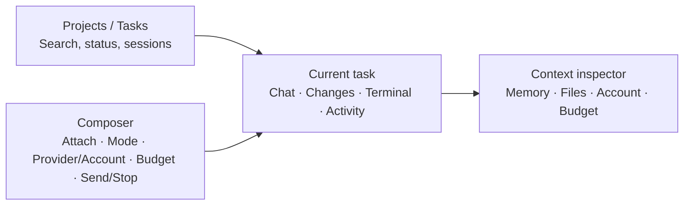

# AgentBridge Product Gap Study

[繁體中文](PRODUCT_GAP_STUDY.zh-TW.md)

**Research date:** 2026-10-26

**Scope:** AgentBridge 0.2.0 source and documentation, plus public first-party documentation for major coding-agent products. This is a feature and positioning study, not a security audit, benchmark, or live provider acceptance test.

### Executive conclusion

AgentBridge is a working foundation for a **local, multi-provider macOS agent workspace**. It combines the official Codex and Claude Code CLIs, separate account profiles, cross-provider memory, commit-pinned Git snapshots, read-only chat, native interactive terminals, and a per-run-confirmed Claude API budget ledger.

Compared with Codex, Claude Code, and Cursor, its largest gap is not model count. It is the missing end-to-end product loop: **assign work → make a safe change → inspect the diff → verify it → accept the result**. App/CLI chat is read-only. Interactive terminal sessions can use each provider's native CLI, but AgentBridge does not provide its own diff review, per-file accept/reject, or safe promotion of results back to a user branch. First-party Codex, Claude Desktop, and Cursor documentation puts session management, isolated workspaces, and change review at the center of the experience. [Codex App](https://openai.com/index/introducing-the-codex-app/) · [Claude Code Desktop](https://code.claude.com/docs/en/desktop) · [Cursor](https://cursor.com/docs)

Position AgentBridge as a **local-control macOS agent workspace differentiated by account choice, cross-provider memory, and transparent spend controls**. Do not try to reproduce every provider's IDE, cloud, and automation platform at once. Make reviewable outcomes reliable first; then add parallel tasks and integrations.

### Current product baseline

This inventory comes from the repository's Swift source, README, architecture document, and How to Use guide:

- **Runtime and UI:** Shared Swift core, `agentbridge` CLI, native SwiftUI app, and embedded terminal. Codex and Claude run through their official local CLIs.
- **Accounts and plans:** Separate CLI account profiles for each provider. Plan details are shown only when the official CLI reports them. Codex uses subscription login; Claude can optionally use its API.
- **Spend and usage controls:** Each Claude API call requires a key, per-run budget, and explicit confirmation. App and CLI share account-scoped monthly/day/session ledgers, local run caps, and manual bill reconciliation; the built-in Claude profile keeps its US$140 monthly cap. The app charts local managed-run activity and shows 50%, 75%, 90%, and 100% alerts. Provider quota percentages and native TUI turns are not available to this local meter; the ledger is not an Anthropic-side hard cap and cannot count use outside AgentBridge.
- **Workspace safety:** New sessions use an isolated clone of the source Git `HEAD`; uncommitted/untracked files are excluded, and changes are never merged or pushed automatically. Normal chat is read-only. Interactive sessions retain provider permissions; the local shell runs as the current macOS user.
- **Memory and sessions:** Successful read-only app/CLI turns can share local memory by source repository path and pinned commit. Sharing is per-account and defaults on for new accounts. TUI transcripts are not imported; existing memory can be supplied and handoff notes are manual. Memory does not automatically move to a new commit.
- **Events and logs:** The core stores session state, audit events, and redacted output and supports cancellation, timeouts, per-session run locks, and output bounds. The UI presents completed chat and run status, not a detailed tool-call timeline or diff view.
- **Missing product-level capabilities:** AgentBridge-managed multi-agent delegation, scheduled/background automation, review/accept/restore of changes, a test-and-verify workflow, unified Skills/MCP/plugin management, GitHub issue/PR workflows, attachments and embedded browser, remote collaboration, and automatic updates.

### Gap comparison

| Capability | AgentBridge today | Market baseline | Assessment |
| --- | --- | --- | --- |
| **Deliverable code changes** | App/CLI chat is read-only; interactive TUI can use the provider CLI, but the app has no change list or acceptance flow. | Codex App, Claude Desktop, and Cursor provide change review/diffs; Claude and Cursor document isolated workspace/worktree workflows. | **P0 gap.** The largest obstacle to using AgentBridge for real engineering work. |
| **Isolation and recovery** | Commit-pinned clone protects the source, but there is no app diff, rewind, patch-apply, or result branch flow. | Codex has worktrees and change review; Claude has worktrees and checkpoints/rewind; Cursor has checkpoints and selective diff acceptance. | A sound snapshot foundation needs a visible result lifecycle. |
| **Multiple sessions/agents** | Multiple sessions can exist, but there is no task decomposition, parallel-agent board, agent-to-agent messaging, or central monitoring. | Codex emphasizes parallel agents; Claude offers subagents, background work, and experimental agent teams; Cursor offers cloud/background agents. | **P1 gap.** Finish the single-task review loop before parallel write jobs. |
| **Memory and cross-provider continuity** | App/CLI read-only turns can be shared between Codex and Claude, with consent, private storage, redaction, and bounds. TUI transcripts are excluded; memory is commit-scoped. | Codex, Claude, and Cursor offer long-running sessions, memory/context, history, or rewind, usually centered on their own agent. | **AgentBridge differentiator and unfinished area.** Add handoff summaries, search/curation, and explicit cross-commit carry-forward; never silently mix branches. |
| **Skills, MCP, plugins, integrations** | No AgentBridge-wide manager. Provider-native CLI features may still apply, but AgentBridge has no unified install, inspection, or permission-review flow. | Codex, Claude, Cursor, and Gemini CLI expose Skills, plugins, MCP, or extension mechanisms; Claude also offers hooks/subagents and Gemini offers extensions/subagents. | **P1 gap.** Start with read-only, individually approved integrations. Treat external skill instructions as untrusted input, not executable code. |
| **Files, images, live app context** | The app composer is primarily text input; there is no attachment picker, embedded browser/preview, or visual verification loop. | Codex, Claude Desktop, and Cursor provide file context, browser previews, or computer interaction; availability varies by product and plan. | **P2 gap.** Add file/image attachments and local preview before automated computer use. |
| **Permissions and sandboxing** | Non-interactive execution uses direct argv, a sanitized environment, restricted tools, read-only modes, cancellation, and redaction. Interactive Claude and the local shell can have broader access; a clone is not an OS sandbox. | Codex offers system-level sandboxing; Gemini CLI supports macOS Seatbelt or container sandboxes; Claude has permission modes and checkpoints. | **High-priority safety gap.** Expose clear permission profiles and add OS/container isolation or a prominent downgrade warning for edit mode. |
| **Execution observability** | Core events and cancellation exist; the UI lacks tool-call detail, subagent status, retry/wait reasons, per-step timing, and an exportable diagnostic bundle. | Codex, Claude, and Cursor expose agent progress, sessions, or diffs; Cursor team tools include usage/status views. | **P1 gap.** Show what is happening, which account is used, files changed, and the next approval point. |
| **Model usage and budgets** | Claude API only. Account-scoped local run counts, monthly/day/session USD caps, 50%–100% threshold alerts, and bill-based recovery are implemented; unknown cost retains the reservation. No token/model analytics, usage export, configurable warning levels, or provider quota percentages/reset data. | Claude exposes `/usage` and team/Console cost reporting; Cursor has usage dashboards and background-agent spend limits; Codex CLI/App exposes usage information. | **Local execution and spend controls are implemented, with a clear measurement boundary.** Add configurable alert levels, provider-reported quota/reset support if a documented machine-readable source becomes available, and historical export; never present the local ledger as provider-wide usage or a hard cap. |
| **GitHub and team workflow** | Local single-user repository snapshots; no automatic PR creation, issue intake, or shared team state. | Codex, Claude, and Cursor document PR/issue, remote, or background workflows; Cursor also documents Slack/Linear triggers. | **P2 gap.** Add explicit GitHub PR input/output after local review is reliable; avoid cloud authorization as a prerequisite. |
| **Remote work and automation** | Runs on the local Mac; no mobile monitoring, remote worker, schedule, or background automation. | Codex offers automations/remote collaboration; Claude Code includes cloud/remote/scheduled capabilities; Cursor offers web/mobile/background agents. | **P2 gap, with privacy implications.** Build only behind an explicit hosted-environment choice. |

### UI/UX assessment

#### Current AgentBridge screen

`AgentBridgeApp.swift` currently uses a fixed-width, approximately 330-point scrollable left column and a right work area. The left column stacks provider/usage settings, CLI paths, account and memory consent, repository/interactive mode, session creation, and the session list. The right side shows provider/account/repository/commit, terminal actions, shared memory, chat timeline, and composer; an interactive session switches to the terminal pane. The minimum window size is 1160×780.

#### What works well

- **Provider gating is clear:** the Claude API option appears only for Claude; Codex shows subscription login. This follows the rule that selecting Codex should not expose Claude API controls.
- **Account state is visible:** users can check sign-in/plan status and see the provider/profile bound to the current session.
- **Memory is not hidden:** sharing status, turn count, repository/commit, notes, and clear action are visible. New-account sharing can be selected during creation.
- **Native interactive use is available:** embedded and local terminals are present; paid API fields appear only in Claude API mode and require per-run confirmation.

#### Main UI gaps

| Priority | Screen issue | User impact | Recommendation |
| --- | --- | --- | --- |
| **P0** | **The user cannot see what the agent is doing.** The running UI is mainly a spinner/status. Core audit events are not shown as steps, approvals, file activity, or command output. | During a long run it is hard to tell whether work is stuck, waiting for approval, or complete, or which files were touched. | Add an activity timeline for plan, tool/command, account, approval, files, test results, and cancel/retry state. Separate model text from tool execution. |
| **P0** | **There is no Changes view.** The chat has no Git diff, per-file accept/reject, restore, or apply-to-user-branch action. | An interactive CLI may have changed the clone, but the app provides no clear delivery path; read-only chat cannot deliver code changes. | Add a Changes tab with branch/base commit, file list, per-file diff, accept/reject, restore all, patch export, and local branch creation. |
| **P0** | **Permission modes look like preferences.** Interactive mode and Claude usage mode live in settings rather than near the actual run scope. | Users may not understand the differences between read-only chat, Claude Manual approvals, and the local shell. | On session creation, show clear mode cards: Read-only analysis, Isolated changes, Native interactive TUI. Summarize writable paths, network, tools, API spend, memory injection, and cancellation. Keep the selected mode visible during execution. |
| **P1** | **Settings and work navigation share one sidebar.** The session list follows provider, path, account, and project settings. Sessions lack task titles, search, status filters, and archive. | Finding work gets harder as sessions grow; settings visually outweigh the current task. | Make the sidebar project/session/task navigation. Move provider/account/mode into session creation. Add generated titles, search, status filters, rename, and archive. |
| **P1** | **The composer is a plain text field.** There is no attachment/image input, `@file`, screenshot preview, queue, or shortcut guidance; model/effort is not surfaced. | Users must describe file locations manually and cannot easily manage long prompts or queued work. | Add attachments/file references, queue/stop controls, shortcuts, and explicit provider/account/model information. Show “not reported by CLI” instead of guessing unknown fields. |
| **P1** | **Responses have few review actions.** Chat uses ordinary text bubbles without dedicated code blocks/copy, source references, expandable tool output, or message-level rerun/handoff. | Code and long output are harder to use; responses are disconnected from tools and file changes. | Add Markdown, code highlighting/copy, file/line links, collapsible raw output, and message actions for rerun, handoff summary, and copy. |
| **P1** | **Memory permanently occupies workspace height.** The panel sits above chat; long memory and notes reduce space for conversation/terminal. | On smaller windows or long sessions, the main work surface becomes cramped; it is unclear which memory will be sent. | Move memory to a Context inspector. Near the composer show “N memory items will be included,” with preview, include/omit, and summary controls. Keep explicit clear confirmation. |
| **P1** | **Spend status is far from the run action.** Monthly used/reserved/available values live in the left API settings panel while payment confirmation is in the composer. | Users may not see remaining monthly balance alongside the one-run budget before sending. | Beside Claude API send, show per-run cap, monthly used/available, and an unknown-cost note. Keep per-run confirmation and explain that the local ledger is not a provider hard cap. |
| **P2** | **Window and language flexibility are limited.** The minimum size is 1160×780, the left column is fixed, and UI labels are Traditional Chinese. | Small displays, split windows, English users, and assistive workflows are less comfortable. | Make the sidebar and inspector collapsible, add a compact layout, English/Traditional Chinese localization, VoiceOver labels, full keyboard navigation, zoom, and contrast checks. |

#### Recommended main workspace

Keep the Context inspector collapsed by default so chat, changes, or terminal remains the main surface. Show session title, provider/account, source commit, permission mode, and run state at the top. Use tabs for Chat, Changes, Terminal, and Activity. Keep the composer visible at the bottom, with attachment, mode, account, and any Claude API cost confirmation close to Send.

#### UI patterns worth borrowing

- **Codex App:** project/thread navigation, parallel agent monitoring, reviewable diffs/comments, and file/terminal/browser workspaces make it a command center rather than a CLI window. [Codex App](https://openai.com/index/introducing-the-codex-app/) · [Recent Codex features](https://openai.com/index/codex-for-almost-everything/)
- **Claude Code Desktop:** session list, parallel sessions/worktrees, diff review, terminal/files/browser preview, connectors, Skills/Plugins, and usage are part of one workspace. [Desktop docs](https://code.claude.com/docs/en/desktop) · [Extension model](https://code.claude.com/docs/en/features-overview)
- **Cursor:** Ask/Agent/Manual modes distinguish read-only exploration, agent execution, and targeted changes; diff review accepts/rejects work, and MCP tools expose arguments and approvals. [Agent modes](https://docs.cursor.com/agent) · [Diff review](https://docs.cursor.com/en/agent/review) · [MCP](https://docs.cursor.com/context/model-context-protocol)
- **Google Antigravity App:** a direct desktop UI comparator. It organizes work as Projects, supports Git worktrees and project-scoped security settings, and uses a visual sidebar/review pane for plans, diffs, diagrams, screenshots, and browser recordings. Its conversation search/filtering and docked permission prompts also improve navigation and control. AgentBridge’s Chat/Changes/Terminal/Activity and Context inspector are a sound direction, but it still lacks the complete artifact-review flow, isolated-workspace controls, background-task navigation, and visual verification artifacts. [Feature overview](https://antigravity.google/docs/features) · [Artifacts](https://antigravity.google/docs/artifacts) · [Implementation plans](https://antigravity.google/docs/implementation-plan) · [Remote Control](https://antigravity.google/docs/remote-control/) · [Recent UI updates](https://antigravity.google/docs/changelog)
- **Gemini CLI / Antigravity CLI:** a terminal UI comparison for plan review, active-task visibility, command/tool status, permission presets, conversation switching, and recovery. Google says Gemini Code Assist IDE agent mode uses Gemini CLI and recommends Antigravity CLI for its latest Gemini models. The Gemini Code Assist individual/Google AI Pro/Ultra IDE extensions and Gemini CLI service stopped on June 18, 2026, so the older Gemini CLI alone no longer represents Google's current product surface. [Antigravity CLI features](https://www.antigravity.google/docs/cli/features) · [Gemini Code Assist agent mode](https://docs.cloud.google.com/gemini/docs/codeassist/use-agentic-chat-pair-programmer) · [Migration notice](https://docs.cloud.google.com/gemini/docs/codeassist/code-overview)

#### What Google's UI suggests for AgentBridge

Antigravity makes artifacts a first-class part of the workflow: complex work starts with a plan that can be commented on and reshaped; execution surfaces file changes, terminal commands, and browser screenshots/recordings as reviewable artifacts; a Project also scopes worktrees and security settings. AgentBridge should extend its proposed Changes/Activity tabs into an end-to-end review flow: **review plan → monitor execution → inspect visual/command/diff artifacts → comment or approve → apply/revert**. Keep AgentBridge's own conservative authorization and spending rules: do not copy permissive auto-proceed behavior, and keep Claude API budget controls exclusive to Claude API mode.

#### UI implementation order

1. **Build the work-control surface:** activity timeline, Changes tab, diff review, permission summary, and test results. Design these together with the P0 safe-result workflow.
2. **Rework navigation and memory:** put session search/status filters in the sidebar; move memory into an optional inspector with provenance and preview.
3. **Broaden interactions:** attachments, shortcuts, model/effort visibility, localization, compact layout, and accessibility.

UI acceptance should test more than a mockup. Use a small Git repository and walk through new-account sign-in, read-only session, change session, cancellation, diff reject/accept, test run, cross-provider handoff, and Claude API budget review. At each step the UI should make provider/account, permissions, file scope, cost state, and next action clear.

### Recommended priorities

#### P0: Make results safe to accept

1. Add a **Change Session** mode while keeping read-only as the default. Use an isolated Git worktree/branch per change; show base commit, account, provider, and permission scope.
2. Add **diff review and recovery**: file-by-file changes, accept/reject, full rollback, and source-change detection before applying results. Default to a branch or patch; never auto-commit, push, or merge.
3. Add **repeatable verification**: let the user select `.codex/ci.sh`, an existing test target, or a custom command. Show each command, exit code, output, and duration. Pause for approval before network or elevated commands.
4. Turn execution events into a **readable timeline**: prompt, plan, tool/command, approval, file changes, checks, and costs. Do not leave the user with only a final answer.

#### P1: Complete cross-provider continuity

1. Build a provider-neutral **handoff summary** containing the goal, decisions, completed/remaining work, relevant files, verification results, and commit. For native TUI, let the user explicitly save a summary; do not scrape a sensitive transcript.
2. Improve **memory management** with search, pinning, per-turn deletion, and provenance. Moving memory to another commit should be an explicit summarized operation, not silent context mixing.
3. Add a **task center** for isolated runs: status, pause/resume/cancel, retry, completion notifications, and per-task budget. Enable parallel write tasks after diff review is mature.
4. Add a reviewed **extension catalog** for Skills, MCP servers, and hooks: source, version, permissions, and data flow must be visible, with individual activation. Keep non-interactive tools least-privileged; installing a skill must not silently enable an external API or network access.

#### P2: Broaden use cases

- Attachments, image/file references, embedded preview, and browser-based testing.
- Explicit GitHub issue/PR import/export, diff/CI status, and optional Linear/Slack connectors.
- Opt-in remote workers, background schedules, and mobile status; disclose what code/logs leave the Mac.
- Update checks, compatibility checks, redacted diagnostics export, and Traditional Chinese/English UI.

### Product strategy and trade-offs

- **Preserve the differentiation:** local-first operation, official subscription sign-in, separate CLI profiles, consented cross-provider memory, and per-run Claude API authorization with one AgentBridge budget ledger.
- **Do not rebuild each native TUI feature:** let official CLIs handle login and provider compatibility; AgentBridge should unify sessions, workspaces, memory, review, and spend/permission policy.
- **Do not add more models first.** A third provider expands the account, error, event, budget, memory, and acceptance matrix. Make Codex/Claude outcomes reviewable and recoverable first.
- **Where Jev fits:** TypeSafe's Jev skill can guide a coding agent while developing an integration; the skill itself does not make AgentBridge call Jev. Jev is a System One API for typed judgments, not a replacement for a full code-writing agent. If added, make it an optional decision provider with its own budget and authorization. [TypeSafe Agent Skill](https://docs.typesafe.ai/agent-skill) · [TypeSafe's Jev introduction](https://typesafe.ai/blog/introducing-system-one-models-and-jev)

### MVP acceptance criteria

- Every app-created change session shows its base commit, current status, and complete diff.
- The agent cannot modify the user's source worktree before explicit acceptance; cancellation/failure leaves no orphan processes or ambiguous workspace.
- Before accepting a result, the user can inspect verification commands, their results, and pending approvals; there is no automatic commit/push/merge.
- A Codex → Claude handoff (and the reverse) can reproduce the necessary context while identifying repository, commit, and memory provenance.
- Subscription mode does not read an API key; every Claude API call is authorized; unknown cost is never counted as zero.
- Provider/version changes produce clear compatibility errors instead of a false success response.

### Research limits

This study uses the AgentBridge 0.2.0 working tree and public first-party docs read on 2026-10-26. Plan level, admin policy, previews, and rollout can change product capabilities. No identical task set was run across products, and this does not score model quality, cost, or speed. A quantitative follow-up should run 8–12 identical repository tasks with the same permissions, base commit, acceptance criteria, and verifiable usage records.

### Official references

- OpenAI: [Codex App](https://openai.com/index/introducing-the-codex-app/), [Codex for (almost) everything](https://openai.com/index/codex-for-almost-everything/), [Codex plan and CLI usage](https://help.openai.com/en/articles/11369540-using-codex-with-your-chatgpt-plan)
- Anthropic: [Claude Code Desktop](https://code.claude.com/docs/en/desktop), [Extend Claude Code](https://code.claude.com/docs/en/features-overview), [Subagents](https://code.claude.com/docs/en/sub-agents), [Agent teams](https://code.claude.com/docs/en/agent-teams), [Checkpointing](https://code.claude.com/docs/en/checkpointing), [Costs](https://code.claude.com/docs/en/costs)
- Cursor: [Current docs index](https://cursor.com/docs), [Agent overview](https://docs.cursor.com/en/agent/overview), [Background agents](https://docs.cursor.com/background-agent), [MCP](https://docs.cursor.com/context/model-context-protocol)
- Google: [Antigravity App features](https://antigravity.google/docs/features), [Artifacts](https://antigravity.google/docs/artifacts), [Implementation plans](https://antigravity.google/docs/implementation-plan), [Antigravity CLI features](https://www.antigravity.google/docs/cli/features), [Antigravity changelog](https://antigravity.google/docs/changelog), [Gemini Code Assist agent mode](https://docs.cloud.google.com/gemini/docs/codeassist/use-agentic-chat-pair-programmer), [Gemini Code Assist migration notice](https://docs.cloud.google.com/gemini/docs/codeassist/code-overview), [Gemini CLI subagents](https://geminicli.com/docs/core/subagents/), [Sandboxing](https://geminicli.com/docs/cli/sandbox/), [Checkpointing](https://geminicli.com/docs/cli/checkpointing/)
- TypeSafe: [Agent skill](https://docs.typesafe.ai/agent-skill), [Introducing Jev](https://typesafe.ai/blog/introducing-system-one-models-and-jev)
