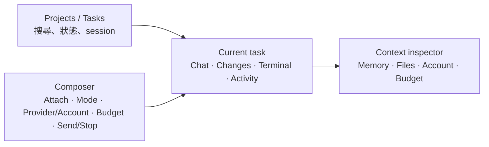

# AgentBridge 產品差距研究

[英文版](PRODUCT_GAP_STUDY.md)

**研究日期：** 2026-10-26

**比較範圍：** AgentBridge 0.2.0 工作樹與主要 coding-agent 產品的官方公開文件。這是功能與產品定位研究，不是安全稽核、基準測試或實際 provider 驗收。

### 結論

AgentBridge 已經是可執行的「本機多供應商工作台」基礎：它把 Codex CLI 和 Claude Code CLI 放進同一個 macOS App/CLI，支援帳戶切換、跨供應商共享記憶、Git 提交快照隔離、唯讀聊天、互動終端，以及逐次確認的 Claude API 額度帳本。

和 Codex、Claude Code、Cursor 等產品相比，最大的差距不是少一個模型，而是**沒有完成「交辦工作 → 安全修改 → 檢查差異 → 執行驗證 → 使用者接受成果」的完整產品流程**。目前 App 的一般聊天是唯讀；互動終端可以交給原生 CLI 操作，但 App 不提供檔案差異審查、逐檔接受/拒絕或把成果安全帶回使用者分支的流程。Codex、Claude Desktop、Cursor 都把工作階段、改動審查與工作區隔離做成主要功能。[Codex App](https://openai.com/index/introducing-the-codex-app/) · [Claude Code Desktop](https://code.claude.com/docs/en/desktop) · [Cursor Agent](https://cursor.com/docs)

建議把產品定位為：**以本機控制、帳戶選擇、跨供應商記憶與透明預算為差異的 macOS agent 工作台**，而不是一次複製各家 IDE、雲端和自動化平台的所有功能。下一階段應優先補齊可審查的成果流程，再擴充平行任務和外部工具。

### AgentBridge 現況盤點

以下項目依本 Repository 的 Swift 原始碼、README、架構文件及使用指南盤點：

- **執行與介面：**共用 Swift 核心、`agentbridge` CLI、原生 SwiftUI App 和內嵌終端；Codex 用官方 `codex` CLI，Claude 用官方 `claude` CLI。
- **帳戶與方案：**Codex/Claude 可各自建立隔離的 CLI 帳戶 profile；方案只顯示 CLI 實際回報的資訊。Codex 固定使用訂閱登入；Claude 可選擇 API。
- **費用控制：**Claude API 每次都要求金鑰、單次預算和付費確認；App/CLI 共用 US$140 的本機月帳本。這不是 Anthropic 端的硬性上限，也無法計入 AgentBridge 以外的使用量。
- **工作區安全：**新工作階段以來源 Git `HEAD` 建立隔離快照，不複製未提交/未追蹤檔案、不自動 merge 或 push。一般聊天限制為唯讀；互動 TUI 保留 provider 原生權限模式。本機 shell 仍以目前 macOS 使用者權限執行。
- **記憶與會話：**成功的 App/CLI 唯讀聊天可依來源 Repository 路徑和固定 commit 共用本機記憶；帳戶可逐一停用，新帳戶預設開啟。互動 TUI 只會收到既有記憶脈絡，不會自動擷取 transcript；需手動寫交接備註。記憶也不會自動從舊 commit 搬到新 commit。
- **事件與日誌：**核心保存 session 狀態、稽核事件和遮蔽後輸出，支援取消、逾時、單一 session 執行鎖和輸出上限；App 主要顯示完成的聊天與執行狀態，沒有可檢視的工具呼叫時間軸或差異面板。
- **尚未由 AgentBridge 提供的產品層能力：**多 agent 任務指派/監控、背景排程、成果差異接受/退回、測試驗證工作流、AgentBridge 自己的技能/MCP/插件管理、GitHub/Issue/PR 工作流、附件與內嵌瀏覽器、跨裝置/雲端協作、自動更新。

### 功能差距比較

| 能力 | AgentBridge 現況 | 外部產品基準 | 評估 |
| --- | --- | --- | --- |
| **可交付的程式修改** | 一般 App/CLI 聊天唯讀；互動 TUI 可使用原生 CLI，但 App 沒有變更清單或接受流程。 | Codex App、Claude Desktop、Cursor 都有工作階段變更審查/差異檢視；Claude 和 Cursor 文件亦說明逐工作區/工作樹操作。 | **P0 差距。**目前最妨礙產品承擔實際開發工作的功能。 |
| **隔離與回復** | 以固定 commit 建立 clone；有來源保護，但沒有 App 內的 diff、還原、套用 patch 或成果分支流程。 | Codex 有 worktree/變更檢視；Claude 有 worktree 和 checkpoint/rewind；Cursor 有 checkpoints 和選擇性接受差異。 | 快照是好底座；需補上使用者可見的成果生命週期。 |
| **多工作階段/多 agent** | 可建立多個 session，但目前沒有任務拆分、平行代理面板、代理間訊息或集中監控。 | Codex 主打平行 agent；Claude 支援 subagent、背景工作和實驗性 agent teams；Cursor 提供 cloud/background agents。 | **P1 差距。**先完成單一工作完整流程，再做平行化，否則只會同時產生多份難審查的工作。 |
| **記憶與跨供應商連續性** | App/CLI 唯讀聊天可跨 Codex/Claude 共用；帳戶同意、私有檔案、遮蔽與大小限制已存在。TUI transcript 不匯入，記憶以 commit 精確分區。 | Codex、Claude、Cursor 各自有長期工作階段、memory/context、歷史或 rewind 能力；通常以自家 agent/session 為中心。 | **AgentBridge 的差異化強項，也是未完成環節。**補 handoff summary、搜尋/整理和明確的跨 commit 搬移；不要偷偷混合不同分支記憶。 |
| **技能、MCP、插件與服務整合** | 產品本身沒有跨 provider 的技能/MCP/插件管理介面；provider 原生 CLI 的功能仍可能存在，但 AgentBridge 沒有統一安裝、檢查或權限審核流程。 | Codex/Claude/Cursor/Gemini CLI 都提供技能、插件、MCP 或擴充機制；Claude 有 hooks/subagents，Gemini 有 extensions/subagents。 | **P1 差距。**可從「只讀且需逐一核准」的 MCP/skills 管理開始。外來 skill 是指令內容，不能當成可信程式碼。 |
| **檔案、圖片與執行中應用脈絡** | App composer 目前以文字輸入為主，沒有附件選擇器、內嵌瀏覽器/預覽或視覺檢查流程。 | Codex、Claude Desktop、Cursor 具備檔案脈絡、瀏覽器預覽/電腦操作等功能；實際可用項目依產品/方案而異。 | **P2 差距。**先支援檔案/圖片附件和本機預覽，再評估全自動電腦操作。 |
| **權限與 sandbox** | 非互動執行採直接 executable/argv、清理環境、限制工具、唯讀模式、取消與遮蔽；互動 Claude 和本機 shell 的權限較廣，clone 不是 OS sandbox。 | Codex 提供系統層 sandbox；Gemini CLI 支援 macOS Seatbelt 或容器 sandbox；Claude 有多種 permission mode 和 checkpoint。 | **高優先安全差距。**把權限呈現為明確模式與範圍，並為「允許修改」模式補上 OS/容器級隔離或清楚降級警示。 |
| **執行可觀測性** | 核心有事件記錄和取消；UI 沒有工具呼叫明細、子 agent 狀態、重試/等待原因、每一步耗時或可下載診斷包。 | Codex/Claude/Cursor 讓使用者追蹤 agent 進度、工作階段和差異；Cursor 團隊工具還有使用量/狀態面板。 | **P1 差距。**建議事件時間軸先顯示「正在做什麼、使用哪個帳戶、改了哪些檔、下一個核准點」。 |
| **模型用量與預算** | 只提供 Claude API。已實作依帳戶區分的本機執行次數、月／日／工作階段 USD 上限、50%–100% 門檻提醒，以及依帳單手動恢復；費用未知時保留預算。仍沒有 Token／模型分析、用量匯出、自訂提醒比例或 provider 額度百分比／重置資料。 | Claude 提供 `/usage` 及 Team/Console 成本追蹤；Cursor 有用量儀表板與背景 agent 支出上限；Codex CLI/App 顯示使用資訊。 | **本機執行與支出控制已具備，並清楚標示計量邊界。**後續補自訂提醒門檻、在 provider 有官方結構化資料時支援額度／重置資訊，以及歷史匯出；絕不可把本機帳本說成 provider 整體用量或硬上限。 |
| **GitHub 與團隊工作流** | 本機單人 Repository 快照；不會自動建立 PR、接收 issue 或同步團隊狀態。 | Codex、Claude 和 Cursor 文件都描述了 PR/Issue、遠端或背景工作流程；Cursor 也支援 Slack/Linear 觸發方式。 | **P2 差距。**等本機成果審查穩定，再做 GitHub PR 輸出；不要一開始就要求雲端授權。 |
| **跨裝置/長期自動化** | App 在本機執行；沒有手機監看、遠端工作節點、排程或背景自動化。 | Codex 提供 automations/遠端協作能力；Claude Desktop/Code 有 cloud/remote/排程相關功能；Cursor 有 web/mobile/background agent。 | **P2 差距，且會改變隱私模型。**只有在使用者明確選擇託管環境後再做。 |

### UI/UX 深度評估

#### AgentBridge 目前的畫面

從 `AgentBridgeApp.swift` 的 SwiftUI 佈局來看，視窗分成固定寬度約 330 點的左側捲動欄，以及右側工作區。左欄依序放助理/provider 與使用模式、CLI 路徑、帳戶和 memory 同意、Repository 路徑/互動終端開關、新建工作階段，以及 session 清單。右欄顯示 session 的 provider/帳戶/Repository/commit、Terminal 動作、共享記憶區、聊天 timeline 和輸入框；互動 session 時切換成終端面板。最小視窗大小是 1160×780。

#### UI 已做得好的地方

- **Provider 狀態有區隔：**Claude API 選項只在 Claude 被選取時出現；Codex 顯示訂閱登入。這符合「選 Codex 不該看到 Claude API」的產品規則。
- **重要帳戶資訊可見：**畫面能檢查登入與方案，並顯示目前帳戶與 session 所綁定的 provider/profile。
- **Memory 不是隱藏行為：**共享狀態、回合數、Repository/commit、備註和清除入口都有畫面位置；新帳戶是否允許共享可在建立時選擇。
- **可直接用原生互動介面：**內嵌終端和本機終端都已存在；API 付款欄位只在 Claude API 模式顯示，並要求逐次確認。

#### UI 主要落差

| 優先度 | 畫面問題 | 使用者影響 | 建議 |
| --- | --- | --- | --- |
| **P0** | **看不到 agent 正在做的具體工作。**目前執行中主要是 spinner/status；工具事件存在核心稽核資料，但 UI 沒有呈現步驟、核准點、讀寫檔案或命令輸出時間軸。 | 執行久時難判斷卡住、正在等核准、還是已完成；也難確認它碰了哪些檔案。 | 加入活動 timeline：計畫、工具/命令、使用帳戶、核准、檔案、測試結果、取消/重試狀態。分開顯示「模型文字」與「工具執行」。 |
| **P0** | **沒有「Changes」檢視。**聊天頁看不到 Git diff，也沒有逐檔接受/拒絕、回復或套用到使用者分支。 | 互動 CLI 可能已改隔離複本，但使用者沒有清楚交付出口；唯讀聊天則完全不能交付程式變更。 | 主工作區加入 Changes tab，顯示 branch/base commit、檔案清單、逐檔 diff、接受/拒絕、全部還原、輸出 patch/建立本機 branch。 |
| **P0** | **模式與權限設定太像偏好開關。**「互動終端工作階段」與 Claude 使用模式都放在左側設定，和這次執行的實際權限不夠靠近。 | 使用者可能不知道「唯讀聊天」、「Claude Manual 核准」和「本機終端」的權限差異。 | 新 session 建立時使用明確模式選擇卡：唯讀分析／隔離修改／原生互動 TUI；同時摘要可寫路徑、網路、工具、API 付費、memory 注入和取消方式。執行中常駐顯示模式。 |
| **P1** | **左欄把設定和工作導覽混在一起。**使用者先滑過 provider、路徑、帳戶和專案設定，才看到 session 清單。session 名稱偏向 provider/profile/commit，沒有標題、搜尋、狀態篩選或封存。 | session 增多後，找工作比執行工作更費力；設定的視覺份量高於當前任務。 | 左欄改成「Projects → Sessions/Tasks」導覽；目前專案的 provider/account/mode 放在新建 session 流程。增加自動標題、搜尋、執行中/待審/失敗篩選、重新命名、封存。 |
| **P1** | **輸入框像單純文字欄。**缺附件/圖片、`@file`、貼上截圖預覽、送出佇列、快捷鍵提示；provider 模式以外也沒有模型/effort 顯示。 | 使用者得手動描述檔案位置，長提示與多工作排程不順；不清楚當前使用哪個模型設定。 | Composer 加附件與檔案引用、停止/排隊按鈕、常用快捷鍵；明確列出 provider、帳戶、可取得的模型資訊與模式。未知的方案或模型欄位顯示「CLI 未提供」，不要猜測。 |
| **P1** | **回覆閱讀和操作能力較弱。**目前聊天以普通文字 bubble 顯示，沒有獨立程式碼區塊/複製按鈕、引用來源、展開工具輸出或訊息上的重新執行/交接動作。 | 程式碼與長輸出不易閱讀；回覆、檔案變更和工具記錄之間沒有明確連結。 | 支援 Markdown、語法高亮、複製 code block、檔案/行號連結、可折疊原始輸出；訊息可「重新執行／存成交接摘要／複製」。 |
| **P1** | **Memory 面板固定佔用工作區高度。**它很重要，但目前在主對話上方常駐，長記憶和備註區會壓縮聊天/終端可用空間。 | 小視窗或長對話時，主要工作區變窄、變短；也不容易看出哪些記憶真的會送給這次 provider。 | 把 memory 移到 Context inspector/側欄；在 composer 旁提供簡短的「將帶入 N 則記憶」控制，可預覽來源、選擇是否帶入、管理摘要。清除前保留明確確認。 |
| **P1** | **費用狀態離執行按鈕太遠。**月度已用/保留/可用額度在左側 API 設定區；付費確認在 composer。 | 送出前可能看不到剩餘月額度和單次預算對照。 | Claude API composer 旁顯示單次上限、月額度已用/可用、預估未知提示；保留逐次確認。將「本機帳本，不是供應商硬上限」用短說明和詳情連結呈現。 |
| **P2** | **視窗尺寸與語言彈性有限。**最小尺寸 1160×780，固定 330 點左欄；UI 目前是繁體中文。 | 小螢幕、分割視窗、英文使用者和輔助使用情境較難適應。 | 左欄可收合、右側 inspector 可隱藏、窄視窗改用導覽 sidebar；加入英/繁中切換、VoiceOver label、鍵盤完整操作、縮放和對比度測試。 |

#### 建議的主要工作畫面

建議預設先收起右側 Context inspector，讓聊天/差異/終端成為主視覺；需要時再打開記憶、檔案和帳戶細節。上方固定顯示 session 標題、provider/account、來源 commit、權限模式和執行狀態；主區用 tabs 切換 Chat、Changes、Terminal、Activity。底部 composer 保持可見，將附件、模式、帳戶及 Claude API 費用確認放在送出動作附近。

#### 外部 UI 值得借鏡的部分

- **Codex App：**以 project/thread 作導覽中心，可平行監看 agent，並回到 diff、留言、檔案、terminal 和 browser 工作區；不只是把 CLI 放進視窗。[Codex App 說明](https://openai.com/index/introducing-the-codex-app/) · [Codex 近期功能](https://openai.com/index/codex-for-almost-everything/)
- **Claude Code Desktop：**session 清單、平行 session/worktree、diff review、終端/檔案編輯/瀏覽器預覽、Connectors、Skills/Plugins、usage 都屬於同一個工作區流程。[Desktop 文件](https://code.claude.com/docs/en/desktop) · [擴充功能模型](https://code.claude.com/docs/en/features-overview)
- **Cursor：**Ask/Agent/Manual 模式把「只讀理解、代理執行、精準修改」區分清楚；diff review 可接受或拒絕變更，MCP 工具能顯示參數並要求核准。[Agent modes](https://docs.cursor.com/agent) · [Diff review](https://docs.cursor.com/en/agent/review) · [MCP](https://docs.cursor.com/context/model-context-protocol)
- **Google Antigravity App：**這是更直接的桌面 UI 對照。它用 Project 管理工作、原生支援 Git worktree 和專案級安全設定；Agent Manager/側欄可組織多個對話，Artifacts 把計畫、diff、架構圖、截圖和瀏覽器錄影做成可檢視、可留言的成果。近期版本還加入對話搜尋/篩選，以及把權限提問固定在輸入框附近。AgentBridge 的 Chat/Changes/Terminal/Activity 與 Context inspector 方向合理，但仍缺少 artifact review、隔離工作目錄控制、背景任務導覽和視覺驗收成果這些完整工作流程。[Antigravity 功能總覽](https://antigravity.google/docs/features) · [Artifacts](https://antigravity.google/docs/artifacts) · [Implementation plans](https://antigravity.google/docs/implementation-plan) · [Remote Control](https://antigravity.google/docs/remote-control/) · [近期 UI 更新](https://antigravity.google/docs/changelog)
- **Gemini CLI / Antigravity CLI：**把它當成終端 UI 的比較：計畫審查、活動任務、命令/工具狀態、權限預設、對話切換與復原都應明確呈現。Google 文件指出 Gemini Code Assist IDE agent mode 使用 Gemini CLI，並建議使用 Antigravity CLI 體驗最新 Gemini 模型；舊 Gemini Code Assist 個人/Google AI Pro/Ultra 的 IDE extension 與 Gemini CLI 服務已於 2026-06-18 停止，故不能只用舊 Gemini CLI 代表 Google 現況。[Antigravity CLI 功能](https://www.antigravity.google/docs/cli/features) · [Gemini Code Assist agent mode](https://docs.cloud.google.com/gemini/docs/codeassist/use-agentic-chat-pair-programmer) · [遷移說明](https://docs.cloud.google.com/gemini/docs/codeassist/code-overview)

#### Google UI 對 AgentBridge 的具體啟示

Antigravity 讓「成果物」成為工作流程的一級介面：複雜工作先產生可留言、可調整範圍的計畫；執行期間把檔案變更、終端命令、瀏覽器截圖/錄影收進可回看的 artifacts；Project 同時界定 worktree 與安全設定。AgentBridge 應把目前建議的 Changes/Activity tabs 往前推成完整審查流程：**先看計畫 → 監看執行 → 查看圖像/命令/差異成果 → 留評論或核准 → 套用／復原**。其中權限與費用仍須採 AgentBridge 自己的保守政策：Google 的自動繼續/專案權限不能直接照搬；Claude API 預算要留在 Claude API 模式，Codex 模式不顯示 Claude API 控制。

#### UI 實作次序

1. **先完成工作控制面：**活動時間軸、Changes tab、diff review、執行模式摘要和測試結果。這與「讓 agent 結果安全可接受」的 P0 引擎工作一起設計。
2. **再整理導覽與記憶：**把 session/search/狀態篩選放進 sidebar；Memory 改為可開關 inspector，新增來源與注入預覽。
3. **最後擴大操作方式：**附件、快捷鍵、模型/effort 顯示、雙語、窄視窗版面和輔助使用。

UI 驗收不應只看視覺稿：找一個小型 Git Repository，走過新帳戶登入、建立唯讀 session、建立可修改 session、取消執行、查看/拒絕/接受 diff、跑測試、把摘要交給另一 provider、在 Claude API 模式檢查預算。每一步都要能從畫面確認「目前 provider/account、權限、修改位置、花費狀態與下一步」。

### 建議優先路線

#### P0：先讓成果可安全接受

1. **新增「修改工作階段」模式**，預設仍為唯讀。每次修改在獨立 Git worktree/branch 執行；清楚顯示來源 commit、帳戶、provider 和權限範圍。
2. **加入 diff review 與復原**：逐檔差異、接受/拒絕、整批撤銷；套用成果前檢查來源 Repository 是否已變動。預設只產生 branch 或 patch，不自動 commit、push 或合併。
3. **加入可重現的驗證步驟**：使用者選擇 `.codex/ci.sh`、既有測試目標或自訂命令；逐步顯示命令、退出碼、輸出和執行時間。網路或高權限命令先停下要求確認。
4. **把工具事件做成可閱讀時間軸**：提示、計畫、工具/命令、核准、檔案差異、驗證與成本分段呈現；不要只留一段最終答案。

#### P1：完成真正的跨供應商工作連續性

1. **跨 provider handoff**：提供「交接摘要」物件，包含目前目標、決策、完成/未完成項、相關檔案、驗證結果和所屬 commit。原生 TUI 先讓使用者明確儲存摘要，不要擷取或猜測隱私敏感 transcript。
2. **記憶管理升級**：可搜尋、釘選、刪除單一回合、顯示來源/時間/供應商；跨 commit 搬移要明確操作並標示為摘要，而非把不同歷史上下文直接混在一起。
3. **任務中心**：多個隔離工作階段的排程/狀態、暫停/繼續/取消、錯誤重試、完成通知與每項預算。待 diff review 成熟後才開平行寫入任務。
4. **整合擴充目錄**：可檢查 Skill、MCP server、hooks 的來源、版本、權限和資料去向；用戶逐個啟用。對 AgentBridge 非互動路徑採最小工具權限，不讓安裝技能自動打開外部 API 或網路。

#### P2：擴大使用情境

- 附件、圖片、檔案引用與內嵌預覽/測試瀏覽器。
- GitHub issue/PR 的明確導入與輸出、PR diff/CI 狀態、可選的 Linear/Slack 連接器。
- 可選遠端節點、背景排程與手機端查看；逐項告知程式碼與日誌會離開本機的範圍。
- 軟體更新檢查、相容性檢查、可遮蔽的診斷匯出、繁中/英文 UI。

### 產品策略與取捨

- **保留差異化：**本機優先、官方訂閱登入、不同使用者各自 CLI profile、跨供應商共享記憶且有帳戶同意、Claude API 每次確認與單一 AgentBridge 預算帳本。
- **不要把所有原生 TUI 功能重做一次：**用官方 CLI 保持登入與模型相容性；AgentBridge 專注統一 session、工作區、memory、review 和費用/權限政策。
- **不要先加更多模型。**第三個 provider 會增加帳戶、錯誤、事件、費用、記憶和驗收矩陣；先讓 Codex/Claude 的修改成果可審查、可復原。
- **技能與 Jev 的位置：**TypeSafe 的 Jev skill 可供 coding agent 在開發時參考；skill 是整合指引，不會讓 AgentBridge 自動呼叫 Jev。Jev 是輸出型別化判斷的 System One API，不是取代 Codex/Claude 的完整程式代理；若要加入，應當作可選 decision provider 並納入獨立預算/授權。[TypeSafe Agent Skill](https://docs.typesafe.ai/agent-skill) · [TypeSafe 對 Jev 的介紹](https://typesafe.ai/blog/introducing-system-one-models-and-jev)

### 建議的 MVP 成功條件

- App 內建立的每個修改工作階段都可以看到 base commit、目前狀態與完整 diff。
- 未經明確接受，agent 不能改動使用者來源工作樹；取消/失敗後沒有遺留程序或不明 workspace。
- 接受成果前可以查看驗證命令、逐項結果和待處理核准；不自動 commit/push/merge。
- Codex → Claude（及反向）的手動交接能重現必要狀態，且顯示其 Repository、commit 和記憶來源。
- 訂閱模式不讀取 API key；Claude API 呼叫逐次授權，費用未知時不把帳本誤算為零。
- 供應商版本/API 變更時有可理解的相容性錯誤；不把失敗包裝成成功答案。

### 研究邊界

這份評估是以 2026-10-26 當天讀取的 AgentBridge 0.2.0 工作樹及官方公開文件為基礎；不同方案、管理員設定、預覽功能和 rollout 可能改變產品能力。沒有對各產品執行同一組任務，也沒有評分模型品質、成本或速度。下一步若要做量化比較，應設計 8–12 個相同 Repository 任務，以相同權限、基準 commit、成功條件和可核實的用量記錄實測。
